# Fix pass 4 — report

## 1. Code-explain scenes with no `code`

The laptop branch `fix/ep26-32-code` (50c59a4, 8979e97, 65d6ff4) already had `scripts/add_scene_code.mts` and the code for
EP26 and EP28–32. Fix pass 4 is rebased onto it, and no second script was written. The laptop data for EP26 and EP28–32 is
used as is (re-running the script on them changes nothing).

**What I extended in the laptop script** (it could not handle these cases):
- It only read `docs/bible/m04.md`. It now finds the module file that holds the "## EP n" heading, and it reads CRLF
  module files (m06 is one).
- It paired Bible code blocks with scenes by position and skipped an episode when the counts differed. A target can now have
  `pick: [..]`, the 1-based Bible pair each scene shows (EP41, 44, 59, 61 and 71 have more programs than target scenes;
  EP71 shows `binread.c` twice).
- The file name is also read when it is bare at the start of the onScreen text ("ep41_arrays.c types itself"), and a target
  can give `names` for a scene that names no file (EP61 scene 7 → `ep61copy.c`).

Result for the 12 scenes added in this pass: a deep-equal against `HEAD` shows only `scene.code` changed in the 7 files, every
source compiles with `gcc -Wall -Wextra`, and the sources and outputs are identical to my own earlier mapping.

The scan of EP20–86 for code-explain scenes without code found the list in the brief plus EP59 s5, EP61 s7, EP69 s6/s9,
EP70 s4/s6 and EP71 s4/s5/s7/s8. Nothing else.

| Episode | Scene | File shown | Source | Done by |
|---|---|---|---|---|
| EP26 | 5, 8 | `sorry.c`, `double.c` | Code shown, blocks 1, 2 | laptop |
| EP28 | 1 | `ep27_table7.c` | EP27 challenge answer, wrapped in `main` | laptop |
| EP28 | 3, 4, 6 | `once.c`, `dowhile.c`, `menu.c` | Code shown, blocks 1–3 | laptop |
| EP29 | 5, 8 | `brk.c`, `skip3.c` | Code shown, blocks 1, 2 | laptop |
| EP30 | 4, 6 | `nested.c`, `times.c` | Code shown, blocks 1, 2 | laptop |
| EP31 | 4, 5, 7 | `tri.c`, `invtri.c`, `rt4.c` | Code shown, blocks 1–3 | laptop |
| EP32 | 4, 5, 7 | `pyr.c`, `diamond.c`, `floyd.c` | Code shown, blocks 1–3 | laptop |
| EP41 | 5 | `ep41_arrays.c` | Code shown, block 1 | this pass |
| EP44 | 6 | `ep44_swap.c` | Code shown, block 1 (narration walks lines 4–25: swap plus one bubble pass) | this pass |
| EP59 | 5 | `double.c` | Code shown, block 1 | this pass |
| EP61 | 7 | `ep61copy.c` | Code shown, block 2 | this pass |
| EP69 | 6, 9 | `write.c`, `append.c` | Code shown, blocks 1, 2 | this pass |
| EP70 | 4, 6 | `readlines.c`, `marks.c` | Code shown, blocks 1, 2 | this pass |
| EP71 | 4, 5, 7, 8 | `binwrite.c`, `binread.c` (x2), `update.c` | Code shown, blocks 1, 2, 2, 3 (the two `binread.c` scenes show lines 1–22 and 24–32; the panel holds the whole file) | this pass |

### Pick list: which Bible block each scene shows, and the narration it matches

Used where the Bible's "Code shown" has more programs than target scenes (`pick` in `scripts/add_scene_code.mts`).
"Block" is the Nth code block (with its output block) in the episode's "### Code shown". The narration column quotes the
line cue in the scene's narration and the matching line of the chosen block.

| Episode | Scene | Block | File shown | Narration line it matches | Other blocks (used elsewhere) |
|---|---|---|---|---|---|
| EP41 | 5 | 1 of 4 | `ep41_arrays.c` | "Line four creates the array and fills it in one go" ↔ line 4 `int marks[5] = {78, 92, 65, 88, 71};` | 2–4: the other array examples (initialisers, `b = a`) |
| EP44 | 6 | 1 of 2 | `ep44_swap.c` | "Line eight, a is 10, b is 20 … Line nine, temp equals a … Line fifteen, a loop … i < n − 1" ↔ lines 8, 9, 15 | 2: the wrong `a = b; b = a;` swap shown in scene 4 |
| EP59 | 5 | 1 of 2 | `double.c` | "Line 4: bus equals 42. Line 5: p points to bus. Line 6: int star star pp" ↔ lines 4–6 | 2: `bigger.c` (a later scene) |
| EP61 | 7 | 2 of 2 | `ep61copy.c` | "Write struct Student s3 equals s1, and every member is copied" ↔ line 11 `struct Student s3 = s1;` | 1: `ep61.c` (scene 4, already had it) |
| EP71 | 4 | 1 of 3 | `binwrite.c` | "an array of 3 students, filled in … fwrite" ↔ line 16 `fopen("students.dat", "wb")` | |
| EP71 | 5 | 2 of 3 | `binread.c` | "fopen with "rb" … while fread" ↔ line 10 `fopen("students.dat", "rb")` | |
| EP71 | 7 | 2 of 3 | `binread.c` | "Every record is 28 bytes … fseek … ftell" ↔ lines 27–28 `fseek(fp, 0, SEEK_END); … ftell(fp)` (same program as scene 5) | |
| EP71 | 8 | 3 of 3 | `update.c` | "fopen with "r plus b" … changing one record" ↔ line 10 `fopen(…, "r+b")`, line 19 `fseek(fp, pos, SEEK_SET)` | |

EP69 (scenes 6, 9) and EP70 (scenes 4, 6) need no pick: their scene file names (`write.c`, `append.c`, `readlines.c`, `marks.c`)
pair one to one with the two blocks in each Bible section, and EP41/44/59/61/71 above are the only episodes where the
block count and scene count differ.

### `check_c.py` for the episodes changed in this pass

| Episode | PASS | Non-PASS | Cause |
|---|---|---|---|
| EP41 | 5 | `file3.c` COMPILE-ERROR | Deliberate: `b = a;` on arrays is the lesson. Expected. |
| EP44 | 4 | none | |
| EP59 | 4 | none | |
| EP61 | 4 | none | |
| EP69 | 4 | none | |
| EP70 | 2 | `file1.c`, `file2.c` OUTPUT-MISMATCH (empty output) | They read `diary.txt` / `marks.txt`, made by earlier programs; the checker runs each file alone. |
| EP71 | 3 | `file2.c`, `file3.c` OUTPUT-MISMATCH (empty output) | They read `students.dat` made by `binwrite.c`. Same limit. |

No failure is a fault in the added code. I ran the chains by hand in a scratch folder: EP69 `write.c` + `append.c` →
EP70 `readlines.c`; a 3-line `marks.txt` → EP70 `marks.c`; EP71 `binwrite.c` → `binread.c` → `update.c`. Every output matches the Bible.
EP26–32 were checked by the laptop; earlier runs here gave: EP26 `wrong.c` TIMEOUT (deliberate infinite loop), EP28
`menu.c` TIMEOUT (needs typed input), EP29–32 all PASS. `docs/c-check-summary.md` is regenerated by the tool and is left uncommitted.

## 2. Outro: why the next-episode title was dropped

`sceneProps.ts` parsed the Bible's outro line with `/EP\s*(\d+)\s*[·-]\s*(.+?)…/`. It only matched
"Next: EP 43 · Title" (a `·` or `-` between number and title). The Bible has many other wordings, for example
"Next: EP 43 Searching" (EP41–50 mostly), "Next: EP 27, the for loop", "Module 6 complete; next: EP 47 Strings",
"Next: Module 8 Pointers, EP 52", and "Next: EP 34" with no title at all. Any miss fell through to the literal
"Next episode", which rendered as "EP 43 · NEXT EPISODE".

Fix: the next episode is always `ep + 1` (checked against all 85 outro lines: every wording names `ep + 1`).
Its title now comes from `src/lib/episodeTitles.ts`, generated by `scripts/gen_episode_titles.mts` from each
episode's title card ("EP 43 · SEARCHING"). All 86 title cards parse. The component picks 76px or 64px for long
titles. EP86 has no next episode, so its card says "Thank you / 86 episodes. You did it."

## 3. TitleCard: long titles over Xecxec

The title card shows the full episode title (up to 51 characters, for example EP50's
"String Manipulation: Is "malayalam" a Palindrome?"). At a fixed 128px it needed 3–4 lines and ran into the mascot
(bottom right, top edge near y = 610). `src/lib/titleFit.ts` now steps the size down (128 → 72px) until the title
fits a box of 1555x360, and the title block is centred in the area above the mascot (padding 200 / 96 / 420).
All 86 titles fit. The worst is EP50 at 96px on 3 lines; 24 titles use a size below 128. A 720p still of EP50 confirms
it: three lines, clear of Xecxec.

## 4. EP43 search scenes

`scripts/add_search_highlights.mts` adds, to the EP43 `trace` entries only, `compare: [i, i]` (the Bible's "Compared"
column names the box) and, on the step that finds the value, `sorted: [i]`. `AlgorithmBars` already paints compare
in butter and sorted in mint, so no component change was needed. Linear search checks boxes 0–5 and box 5 turns mint;
binary search checks box 3, then box 5 (mint). Verified: apart from `trace`, the file is identical to `HEAD`.

Not done (flagged): the Bible says the discarded half greys out in binary search ("bars 0–3 grey"). The trace has no
field for it. The "Swaps: 0" and "Pass N" chips also still show on search scenes.

## 5. BugOfTheDay error panel

`src/lib/errorExcerpt.ts` picks at most two lines of the Bible's error text. For GCC diagnostics: the first
`error:`/`warning:` line plus the echoed source line. For "no error, wrong output" bugs: the **last** two lines of the
output block (the wrong value is usually at the end, for example EP41's `marks[5] = 32767`), not the first two,
because the first two would show only correct values. The prose lead-in ("GCC gives no error ...") is never shown.
Font size now goes up to 44px (it was 28px at most) and long lines wrap.

## 6. Short cards with tiny content

Cause for EP43 S1: the bits visual matched the bare digits "1000" in "1000 NAMES → 10 STEPS" and drew the
binary number 10 in a small card. The same false positive hit EP23 S1 ("1, 2 or 3?" read as "2 OR 3"). Both fixed
in `shortVisual.ts` (word operators must be capitals, bare 0/1 runs no longer count). Across all 430 Shorts only these
two visuals changed: EP23 S1 now shows the beach-shack menu analogy, and EP43 S1 is a text card. Text cards already
scale to fill (56–140px). The terminal card (EP04 S1, EP69 S1) now fits its font to the slot (40–80px, was 40/48px).

## 7. Outro check for EP1–86

`node scripts/check_outro_titles.mts` runs the real `scenePropsFor` for every episode and prints the outro line from the
Bible next to the next-episode number and title the Outro receives. It exits 1 if any title is missing or the number named in
the Bible line differs. Result: **all 86 outros show a title**. Both families the laptop review saw are covered:

| Bible wording | Episodes | Shown |
|---|---|---|
| "Next: EP 21 else-if ladders; sign-off" (no `·`; also "Next: EP 27, the for loop", "Next: EP 34", "… and Next: EP 29") | EP20–34 | `EP 21 · ELSE-IF LADDERS`, `EP 27 · THE FOR LOOP`, `EP 34 · WHAT ARE FUNCTIONS?` |
| "Next: EP 35 · Parameters & return values" (with `·`) | EP34–40, EP1–19 | `EP 35 · PARAMETERS & RETURN VALUES` |
| "Next: EP 43 Searching" (EP41–50), "Module 6 complete; next: EP 47 Strings", "Next: Module 8 Pointers, EP 52" | EP41–83 | `EP 43 · SEARCHING`, `EP 47 · STRINGS` |
| EP86: thank-you card, no next episode | EP86 | "Thank you / 86 episodes. You did it." |

Before the fix only the `·` form worked, so EP20–33 and EP41–51 and others lost the title; the laptop saw it from EP35 on
because EP34–40 use the `·` form. The full list (86 lines) is the output of the script.

## 8. Terminal strip and title cards (checked at 540p)

- **Terminal strip beside the explanation card (EP20, EP25).** The program-output panel was sized for 306px of height. EP20's
  output has 11 lines and EP25's has 14, which needed 24px type and still overflowed. `src/lib/outputFit.ts` now picks the size
  (34 → 26px). If the output cannot reach 28px under the explanation card and tracker (142 outputs in EP1–86: 97 stay in the
  normal slot, 45 do not), the terminal takes the whole right column once it starts printing (the last 22% of the scene)
  and the explanation card and tracker step aside. The worst cases (EP21: 17 lines, EP28: 24 lines) are cut with "…" at 26px.
- **EP31 and EP32 titles.** With the current `titleFit` both titles (2 and 3 lines) stay clear of Xecxec: 540p stills of the
  title card for EP31, EP32 and EP51 (and a 720p still of EP50) checked by eye. The laptop review may have been of a render made before the
  TitleCard commit. No further change was needed.

## 9. Follow-ups after review

**EP71 scene 4: highlight on `fwrite`, not `fopen`.** Confirmed from the narration cues of `binwrite.c`: `[HL 16]` ("fopen,
students dot dat, wb. The b means binary") lands on line 16, the `fopen` line, with its own sentence; `[HL 17]` is the NULL
check; `[HL 22]` ("size_t written equals fwrite, s, sizeof struct Student, 3, fp. fwrite takes four things …") lands on line 22,
the `fwrite` line, and its explanation sits under that cue. `[HL 23]` is `fclose`. (In the pick-list table above, line 16 is
the `fopen` line the scene passes first; the `fwrite` call is line 22.)

**EP43 search scenes: chips.** `AlgorithmBars` now shows "Pass N" only when the trace has pass labels ("1.2"), and a trace with
neither passes nor swaps shows "Checks: n" and no "Swaps" chip. Affected traces: EP42 scene 4 (max/min), EP43 scenes 3 and 5
(linear and binary search), EP73 scenes 3 and 4. Sorting traces (EP44, EP74, EP75, EP79) are unchanged.

**Long terminal output: what is cut.** The font now goes down to 22px before anything is cut. Across EP1–86 (142 program
outputs) exactly one scene still does not fit: **EP28 scene 6 (`menu.c`, 24 lines)** drops its first 8 lines and keeps the last
16, with "…" on top. The 8 dropped lines are: an empty line, then `1. Check balance`, `2. Add 100`, `3. Exit`, `Choice: 1`,
`Balance: 500`, an empty line and `1. Check balance`. This is the first round of the menu; the rounds shown still include the
full menu twice, `Added! Balance: 600`, `Invalid choice` and `Bye!`. EP21 scene 4 has 17 lines and now fits whole, at 22px. The
long ones that fit without cutting: EP20 (11 lines, 34px), EP22 (10, 28px), EP24 and EP25 (14, 26px), EP83 (14, 26px).

Real-props stills at 540p (props from `scenePropsFor` on the real episode JSON; EP21 and EP28 have no narration on this PC, so
the highlight cues are the defaults and the highlighted line is not the narrated one):

## 10. EP41–50 540p drafts after fix pass 4

Re-rendered with all fix-pass-4 changes (queue order EP42–50, then EP41; one job at a time, `--scale=0.5`, `out/draft540`; the first-round drafts are kept in `out/old540`). All 60 files (10 long, 50 Shorts) are DONE, with no black frames, loudness −16.0 LUFS, and long-video true peak between −1.64 and −1.71 dBTP (Shorts −3.4 to −4.1 dBTP). **PROVISIONAL: checked by the automatic rules and a look at the EP43 contact sheet; the other sheets are not reviewed.**

| Episode | Long video time | Size | LUFS | True peak | Shorts | Worst Short true peak | Result |
|---|---|---|---|---|---|---|---|
| EP41 | 4m09s | 26.1 MB | -15.99 | -1.69 dBTP | 5 | -3.76 dBTP | PASS |
| EP42 | 3m44s | 23.7 MB | -16 | -1.67 dBTP | 5 | -3.85 dBTP | PASS |
| EP43 | 4m11s | 26.1 MB | -16.01 | -1.68 dBTP | 5 | -3.93 dBTP | PASS |
| EP44 | 4m03s | 25.1 MB | -16 | -1.69 dBTP | 5 | -3.92 dBTP | PASS |
| EP45 | 3m15s | 21.0 MB | -15.99 | -1.71 dBTP | 5 | -3.88 dBTP | PASS |
| EP46 | 3m39s | 23.8 MB | -15.99 | -1.66 dBTP | 5 | -3.38 dBTP | PASS |
| EP47 | 3m33s | 23.2 MB | -16 | -1.67 dBTP | 5 | -3.92 dBTP | PASS |
| EP48 | 3m40s | 24.9 MB | -16 | -1.71 dBTP | 5 | -3.79 dBTP | PASS |
| EP49 | 3m57s | 26.6 MB | -16 | -1.68 dBTP | 5 | -3.89 dBTP | PASS |
| EP50 | 3m45s | 25.0 MB | -15.99 | -1.64 dBTP | 5 | -3.81 dBTP | PASS |

Contact sheets: `out/draft540/epNNN/*.sheet.png`. EP43 sheet shows the Checks chip, the moving butter box, the mint found box and the two-line bug panel.

## 11. Terminal takeover: wider, taller, larger type (follow-up)

Laptop frames showed the takeover panel at about 36% of the width and 45% of the height with the lower half empty and type
near 22px. Changes (`src/lib/outputFit.ts`, `src/scenes/CodeExplain.tsx`):

- **Width.** When an output takes over the right column, the code panel is narrower for the whole scene (870px, was 1002px; no
  reflow mid-scene) and the terminal is 810px wide, 42.2% of the 1920px frame (was 678px, 35%).
- **Height.** The panel stretches over the full column, y 96 to 790 (694px, 64% of the frame; was content-sized at about 486px).
  Xecxec's "It runs!" bubble is not shown in takeover mode, because it would sit on the panel's bottom edge.
- **Type.** Takeover sizes are 30, 28, 26 and 24px (minimum 24, was 22). The largest that fits is used. "…" with the last lines kept
  applies only if 24px does not fit. The normal slot (short outputs under the explanation card) is unchanged.
- **Result over EP1–86** (the 45 takeover outputs): 43 at 30px, EP21 s4 at 26px with nothing cut, EP28 s6 at 24px, and **only EP28 scene 6
  is cut**: 24px, the first 6 of its 23 lines dropped (a blank line, the first menu `1. Check balance / 2. Add 100 / 3. Exit`,
  `Choice: 1`, `Balance: 500`); "…" is shown on top and the last 17 lines are kept.

540p stills of the real props, at the end of each scene (`docs/fix4/takeover-*.png`):

| Scene | Lines | Size | Cut | Still |
|---|---|---|---|---|
| EP20 s4 | 11 | 30px | none |  |
| EP21 s4 | 17 | 26px | none (was 2 cut) |  |
| EP25 s4 | 14 | 30px | none |  |
| EP28 s6 | 23 | 24px | first 6 lines |  |
| EP83 s5 (other long output) | 14 | 30px | none |  |

Nothing was re-rendered. Which episodes pick this up is for you to say. Takeover scenes exist in EP8, 9, 11, 14, 16, 20–22, 24, 25, 27–29,
32, 41, 47, 51, 52, 56, 61, 64, 65, 72, 74–77, 81, 83 and 84.

## 12. Bug of the Day panels: excerpt rules (branch `fix/bug-excerpts`, not merged yet)

`src/lib/errorExcerpt.ts` now classifies the Bible's "error" text instead of taking the second block blindly.
`node scripts/bug_excerpts.mts --old=<old errorExcerpt.ts>` prints the panel text for all 86 episodes and marks changes.

| Rule | Shows | Episodes that use it |
|---|---|---|
| diagnostic | the `file:line:col: error/warning: text` line + the echoed source line (a bare heading like "GCC error:" no longer counts) | EP1, 4, 6–12, 15, 20, 22–24, 28, 34–37, 39, 44, 46, 49, 51–58, 60–63, 68, 77, 81, 82, 86 (EP36 changed) |
| myth | the first numbered proof; the quoted claim is added above it only if the code card does not already show it (compared after normalising quotes) | EP2 (changed) |
| output | the last two lines of the program-output block, skipping shell commands and prose lead-ins | the rest; EP5 changed |
| crash | prose-only text that names a crash: that message | EP59, 65, 69, 79 (changed) |
| override | hand-written table `src/lib/bugOverrides.ts` | EP67, EP73 (changed) |

**Only nine episodes change: EP2, 5, 36, 59, 65, 67, 69, 73, 79.** The other 77 are identical to the old output (checked by the script). Outside
EP1–19: EP36, 59, 65, 67, 69, 73, 79; none are in EP41–50. Nothing is flagged prose-only any more.

540p stills of the nine panels (real props, taken at 60% of the scene, while the error is on screen):

| Episode | Panel text | Still |
|---|---|---|
| EP2 s8 | only the proof line (the claim is already in the card above) |  |
| EP5 s9 | `Namaskar, Goa!` (the old exe's wrong output) |  |
| EP36 | the real GCC error + source line (was "GCC error:") |  |
| EP59 | `Segmentation fault` |  |
| EP65 | `Segmentation fault` |  |
| EP67 | override: `realloc returns NULL and overwrites basket` |  |
| EP69 | `Segmentation fault` |  |
| EP73 | override: `$ ./program`, blinking cursor, `^C`, caption "no output, program hangs" (cursor is in its "on" half in this frame) |  |
| EP79 | `Segmentation fault` |  |

Two things seen in the stills: in EP2 the quoted myth appeared twice, so the rule now drops the claim when the code card already shows it (still re-rendered above),
and the EP73 caption was first drawn in ink on the dark-blue background and was unreadable; it now uses the readable colour for the scene background.

## 13. Bug of the Day code window: does it show the culprit? (report only, nothing changed)

**How the window is chosen.** `BugOfTheDay` draws the wrong code in `CodeBlock` with `maxHeight 410`, font 40, width 1100, and passes no `highlightLine` and no `visibleChars`.
The panel is capped to `floor((410 − chrome) / row height)` rows, which is 5 rows (a wrapped line takes 2 rows, so sometimes only 3–4 lines). With nothing to follow, the panel
scrolls to the end, so the window is always **the last rows of the file**, snapped to whole lines. The fixed code gets the same window. The window never looks at where the bug is.

`node scripts/bug_windows.mts` (pure Node, reads `episodes/*.json` and `src/lib/codeLayout.ts`) mirrors that rule for all 86 episodes and checks the window against the bug's line.
The line is the compiler's own line when the error text has `file:LINE:col: error|warning` and the echoed source matches the code, otherwise the line(s) that differ from the fix
(for a pure insertion, the lines around the gap; for a short fragment fix, the wrong line sharing the most identifiers with the fragment). It is a heuristic; the cases below were spot-checked.

- **Wrong-code window does not contain the culprit: 35 episodes** — EP20, 22, 23, 24, 27, 30, 33, 34, 35, 37, 39, 42, 43, 44, 45, 46, 47, 49, 50, 57, 62, 63, 67, 69, 70, 71, 73, 74, 76, 77, 78, 79, 82, 84, 85.
  Checked by hand: EP67 (culprit line 10, the `realloc` line; window 13–17), EP69 (the `fopen` result is used at lines 4–6; window 7–11), EP43 (the unsorted array is line 4; window 19–22).
- **Culprit not decidable by the script: 3** (no compiler line, no matching line) — EP5, EP25, EP83.
- **Wrong slot is prose, so there is no window: 2** — EP2, EP3.
- **Fixed-code window does not contain a changed line: 18** — EP10, 20, 24, 30, 34, 35, 36, 37, 39, 40, 49, 69, 71, 75, 76, 78, 84, 85.
- The other 46 episodes show the culprit.

Of the 35, 19 are in EP20–50 (EP20, 22, 23, 24, 27, 30, 33, 34, 35, 37, 39, 42–47, 49, 50), and 8 of those (EP42–47, 49, 50) are in the EP41–50 4K masters already rendered.
**EP1–19: no wrong-code window misses its culprit.** EP5 is undecidable by the script, EP2 and EP3 have no code window, and EP10's fixed-code window (4–8) does not show the changed line 6.
The window logic is unchanged. A fix would be to centre the window on the culprit (pass it as `highlightLine`) or show more rows.

## 14. Diagnosis after the EP41–50 4K sheets, and a plan for "fix pass 5" (nothing implemented)

### 14.1 Blank scenes: MemoryBoxes with no data (hypothesis confirmed)

The blank frames (only caption + crab) are **memory-boxes scenes whose JSON has no `boxes`**. `scenePropsFor` passes `scene.boxes ?? []`, and `MemoryBoxes` draws nothing for an empty list.
EP41 was matched by caption text: tile 3 ("first box is not number one") is scene 4, tiles 8 ("0, 0,") and 9 ("a whole array with equals") are scene 7, both `memory-boxes`.
The other listed tiles were matched by position in the timeline: each falls in or right next to a memory-boxes scene of that episode (EP44 s4–5, EP45 s4/s7, EP46 s4/s7, EP47 s3–4, EP48 s3, EP49 s4–5, EP50 s3);
I did not read their captions one by one.

| | Still (540p) |
|---|---|
| EP41 s4, no data: the scene is empty |  |
| EP7 s3, with data (3 boxes): what the component does when it has data |  |

`node scripts/scan_scenes.mts` over all 86 episodes (branch `fix/bug-excerpts`), 1,046 scenes in all:
concept-slide 193, code-explain 160, terminal 92, bug-of-the-day 87, title-card 86, pun-card 86, outro 86, challenge 84, memory-boxes 65, algorithm-bars 21.

- **memory-boxes: 65 scenes; 8 have data, 57 are blank.** The 8 (EP7, 8, 9, 12, 15, 17, 18) were authored by hand in commit `1ca806e`. **Every memory-boxes scene from EP37 to EP83 is blank**, in 31 episodes:
  EP37, 38, 39, 41, 44–50, 52–62, 64–69, 71, 77, 83. EP1–36 have none blank. In EP41–50: 14 blank scenes (EP41 2, EP44 2, EP45 2, EP46 2, EP47 2, EP48 1, EP49 2, EP50 1; EP42 and EP43 have none).
- **algorithm-bars: 21 scenes; 9 have an empty trace** (EP72 s4, EP76 s4–5, EP77 s4, EP78 s4–5, EP80 s4–5, EP81 s4). This is worse than blank: a still of EP76 s4 **throws a TypeError**
  (`trace[-1]` is undefined), so the long render of those episodes would fail. None of them has been rendered yet.

**Proposal A.** (1) Guard both components so an empty data list shows the scene's `onScreen` line as a text card instead of a blank or a crash (stop-gap, a few lines each).
(2) Author the data: a script drafts `boxes` for the 57 scenes from the Bible's scene line and the episode's code (names, values, addresses; array cells with an index under each box for EP41–50 and EP52–71, a 12-cell grid for EP45 s4), then I check each against the narration, as was done for `scene.code`.
Arrays and strings need an "index under each cell" layout, which the current box component does not have, so it needs a small `cells` layout. (3) For the 9 bars scenes: a step trace from the Bible's table where there is one (as for EP43), otherwise generated by running the algorithm on the array from the code.

### 14.2 Bug window: the 35 was a lower bound

`scripts/bug_windows.mts` now aligns the fixed lines to the wrong lines by token similarity (an aligned pair that differs is a changed line; unmatched fixed lines are insertions, so the wrong lines around the gap count) and takes as the *primary* culprit the compiler's line, else the first changed line.
EP41 (the `<=` loop, line 6, window 7–10) is now caught.

- **Window misses the primary culprit: 48 episodes** (was 35): EP20–25, 27, 29, 30, 33–35, 37–51, 57, 62–67, 69–78, 80, 82, 84, 85. 17 of them are confirmed by the compiler's own line.
  With the lenient rule "any changed line visible" the count is 37, so the true figure is between 37 and 48.
- **Fixed-code window misses a changed line: 16**: EP20, 24, 30, 34, 35, 36, 39, 40, 49, 69, 71, 75, 76, 78, 84, 85.
- Checked by hand and correct: EP41, 43, 67 (`realloc` line 10 vs window 13–17), 69 (`fopen`/`fprintf` lines 4–6 vs 7–11), 21 (the ladder order, lines 6–10 vs 11–15), 38.
  Not reliable where the "fixed" code is a different program (EP64): the culprit list there is noise.
- **EP1–19: no wrong-code window misses its culprit** (EP5 undecidable, EP2/EP3 no code window). EP41–50: all 10 miss.

**Proposal B (not implemented).** Compute the culprit line at build time (`src/lib/bugCulprit.ts`, the same alignment code) with a small override table for the unreliable cases (EP64 and any other rewrite).
`BugOfTheDay` passes it as `highlightLine` to `CodeBlock`: the existing scroll logic then centres the highlighted line in the 5-row window, and it gets the butter highlight when the error appears (wrong panel) and on the first changed line when the fix lands (fixed panel).
The window size stays; only where it looks changes.

### 14.3 Explanation card overflowing into the TRACKER chips

Seen in `docs/fix4/card-overflow-ep42-s5.png`, `-ep45-s5.png`, `-ep49-s7.png` (720p, real props).

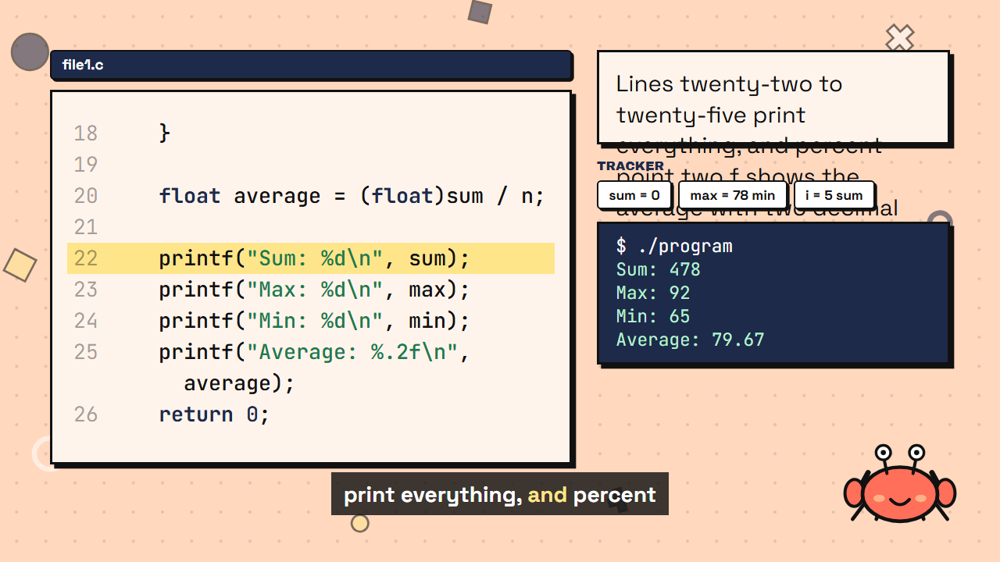

**Rule.** The right column is a flex column of fixed height, 604px when a program output is on the scene (1080 − 2×96 − 284 reserved for Xecxec). It holds the card, the tracker (about 90px), and the output panel,
which takes its room from the first frame (it is only invisible before it prints). When card + tracker + output + gaps is more than 604px, flexbox shrinks the card to its `minHeight: 160`, but its text keeps its full height
(44px type, about 24 characters per row) and spills over the tracker. About 2 rows fit; 3 or more spill. The labels come from the narration (up to 140 characters): EP42 s5 "Lines twenty-two to twenty-five print everything, …" is 5–6 rows, EP45 s5 "Line eighteen, …" 3 rows, EP49 s7 "Line nineteen: strcmp …" 4 rows.

`node scripts/scan_label_overflow.mts` (an estimate from the row/height arithmetic, not a render): **97 scenes, 442 labels, 70 episodes** overflow, including EP1–19 episodes 6–11, 13–16, 18, 19 (so the existing EP1–19 4K masters most likely have it too; nobody had noticed).
It does not flag EP46, which matches what was seen in the EP41–50 sheets.

**Proposal C (not implemented).** Fit the card's text to its room instead of letting flex shrink the box: `flexShrink: 0`, and pick the font from 44, 40, 36, 32, 28 so `rows × size × 1.35 + 74` fits the room left by the tracker and output panel (never below 160);
if it still does not fit at 28px, shorten the label to its first clause (cut at the first comma or at 90 characters). In takeover mode the card hides while the output prints, as now.

### 14.4 Plan for "fix pass 5" and the re-render list

**Items:** A (MemoryBoxes data, a text fallback for empty data, 9 bars traces), B (bug window centred on the culprit, plus the nine excerpt changes already on `fix/bug-excerpts`), C (card text fit), D (takeover and bug excerpts are already coded and only need rendering).
**Order:** 1. merge `fix/bug-excerpts`; 2. guards for empty boxes/bars (so nothing can crash or go blank); 3. C and B (code only, small); 4. A (data authoring, the big one: 57 scenes, 9 traces); 5. stills of every changed template at 540p for your review; 6. renders.

**Which masters exist.** Only EP41–50 have 4K masters from this pass (built from `83248dd`); EP1–19 are queued for re-render; **EP20–40 and EP51–86 have never been rendered at 4K**, so for them these fixes just have to be in place before their first render.
The six EP72–81 bars episodes and every blank-MemoryBoxes episode from EP37 on must not be rendered before item A.

**Result:** EP1–19: 14 of 19 need a re-render (EP2, 5, 6, 7, 8, 9, 10, 11, 13, 14, 15, 16, 18, 19; not EP1, 3, 4, 12, 17). EP41–50: all 10.

### Per episode (A boxes, B excerpt or window, C card; "takeover" is already coded)

### EP1–19 (4K masters to be re-rendered)

| Episode | A boxes | B excerpt | C window | D card | takeover | Re-render |
|---|---|---|---|---|---|---|
| EP1 |  |  |  |  |  | no |
| EP2 |  | x |  |  |  | **yes** |
| EP3 |  |  |  |  |  | no |
| EP4 |  |  |  |  |  | no |
| EP5 |  | x |  |  |  | **yes** |
| EP6 |  |  |  | x |  | **yes** |
| EP7 |  |  |  | x |  | **yes** |
| EP8 |  |  |  | x | x | **yes** |
| EP9 |  |  |  | x | x | **yes** |
| EP10 |  |  |  | x |  | **yes** |
| EP11 |  |  |  | x | x | **yes** |
| EP12 |  |  |  |  |  | no |
| EP13 |  |  |  | x |  | **yes** |
| EP14 |  |  |  | x | x | **yes** |
| EP15 |  |  |  | x |  | **yes** |
| EP16 |  |  |  | x | x | **yes** |
| EP17 |  |  |  |  |  | no |
| EP18 |  |  |  | x |  | **yes** |
| EP19 |  |  |  | x |  | **yes** |

### EP41–50 (4K masters from 83248dd, takeover already in)

| Episode | A boxes | B excerpt | C window | D card | takeover | Re-render |
|---|---|---|---|---|---|---|
| EP41 | x |  | x | x | (in 4K) | **yes** |
| EP42 |  |  | x | x | (in 4K) | **yes** |
| EP43 |  |  | x | x | (in 4K) | **yes** |
| EP44 | x |  | x | x | (in 4K) | **yes** |
| EP45 | x |  | x | x | (in 4K) | **yes** |
| EP46 | x |  | x |  | (in 4K) | **yes** |
| EP47 | x |  | x | x | (in 4K) | **yes** |
| EP48 | x |  | x | x | (in 4K) | **yes** |
| EP49 | x |  | x | x | (in 4K) | **yes** |
| EP50 | x |  | x | x | (in 4K) | **yes** |

**Time.** 24 long videos plus Shorts at about 19 minutes each is about 7.5 hours of rendering, one job at a time at concurrency 2.

**Recommendation.** Do not run the EP1–19 move script and render yet: with pass 5 first, EP1–19 are rendered once (14 episodes) instead of twice. If you want EP1–19 sooner, split the pass: **5a** = B (excerpts + window) and C (card), code only, then render EP1–19 (14 episodes, no data authoring needed);
**5b** = A (boxes and traces), then EP41–50 (all 10), and EP20+ later.

## 15. Fix pass 5a: implemented (local, not pushed), EP1–19 evidence, Shorts, and 5b on paper

Merged locally into `feat/module-0` as `438f7af` (merge of `fix/bug-excerpts`), with two small follow-ups after it. No push, no move script, no EP1–19 render.

### 15.1 What changed

- **Bug window centred on the culprit** (`src/lib/bugCulprit.ts`, `BugOfTheDay`, `sceneProps`). The culprit is computed at build time: an override table first (EP5, EP64, EP83, where alignment cannot work),
  then the compiler's own line, then the first changed line of the fix aligned to the wrong code (an added `#include`/`#define` is never the culprit; for a pure deletion the fixed panel points at the line after the gap).
  `BugOfTheDay` passes it as `highlightLine`, so `CodeBlock` centres the 5-row window on it and draws the butter highlight, in the wrong panel and in the fixed panel.
  `node scripts/bug_windows.mts --old` (the old rule, window = last rows): the culprit is hidden in **46 episodes** and the changed fixed line in 34; the new rule: **0 and 0** (EP2, EP3 are prose cards with no window).
- **Explanation card fits its room** (`src/lib/cardFit.ts`, `CodeExplain`). The card no longer shrinks (`flexShrink: 0`). One font size per scene, the largest of 44 / 40 / 36 / 32 / 28 px at which every label fits what the column has left after the tracker
  (measured from the scene's tracked names) and the output panel; a label that still does not fit at 28px is cut to its first clause (a break at least 20 characters in, else 90 characters).
  Across the 147 code-explain scenes that have labels: 49 stay at 44px, 13 at 40, 12 at 36, 16 at 32, 57 at 28; **32 labels in 20 episodes** are cut (EP14, 23, 25, 37, 42, 47, 49, 52, 61–63, 66, 67, 70, 78–81, 83, 84).
  The old rule overflowed in 98 scenes, 71 episodes (`node scripts/scan_label_overflow.mts --old`).
- **Found on the way: raw `[TRACK ...]` cues were showing inside the card text** when the cue sits in the middle of the explained sentence: 14 labels in 9 scenes (EP28 s6, EP37 s5, **EP43 s4**, EP51 s6, EP74 s7, EP76 s7, EP79 s7, EP80 s7, EP83 s7).
  `labelsFromNarration` now strips them. EP43 s4 is in the EP41–50 4K master, so that master shows the raw text too.
- **Preflight gate** `scripts/check_scenes.mts`: a memory-boxes scene with no `boxes` or an algorithm-bars scene with no `trace` fails its episode. `episode_pipeline.mts` runs it before the GCC check, logs each scene, writes the skip log and skips the episode
  (it does not count toward the two-failures-in-a-row stop, so one data gap does not halt the range); `overnight.ps1` prints the list up front. `check_scenes 41 50` currently fails 14 scenes in 8 episodes; `check_scenes 1 19` passes.

### 15.2 540p stills (real props)

| Panel | Still |
|---|---|
| EP41 bug window, wrong panel: the `<=` loop (line 6) is highlighted and in view | 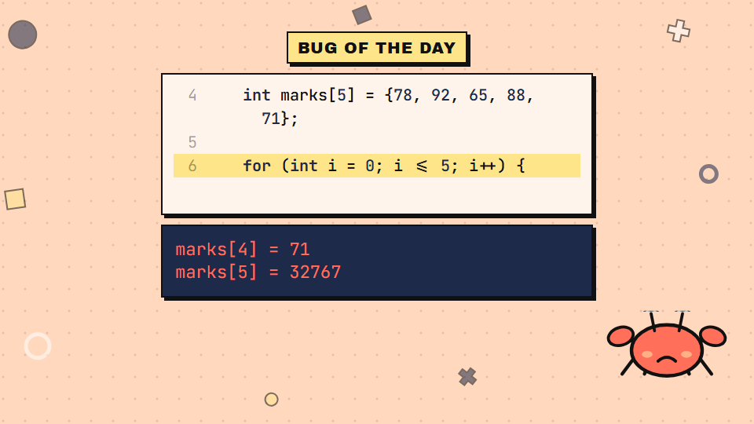 |
| EP43 bug window: the unsorted array (line 4) is highlighted and in view | 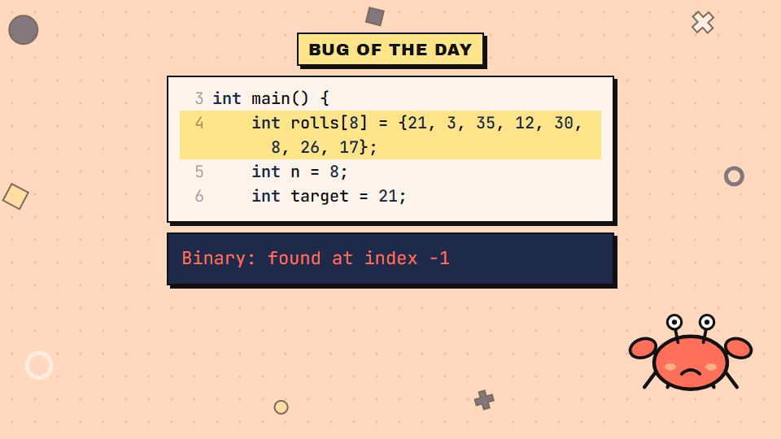 |
| EP10 wrong panel: `PI = 3.0f;` highlighted |  |
| EP10 fixed panel: the line where the fix removed the assignment (the `printf` after the gap) is highlighted | 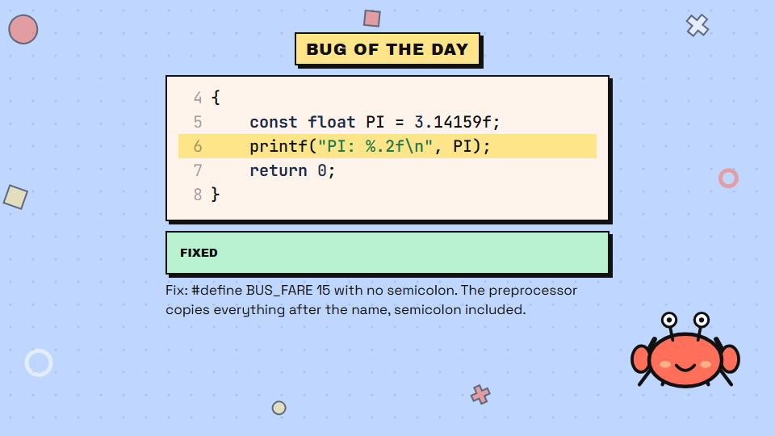 |
| EP42 card (was overflowing, 28px, cut to its first clause) | 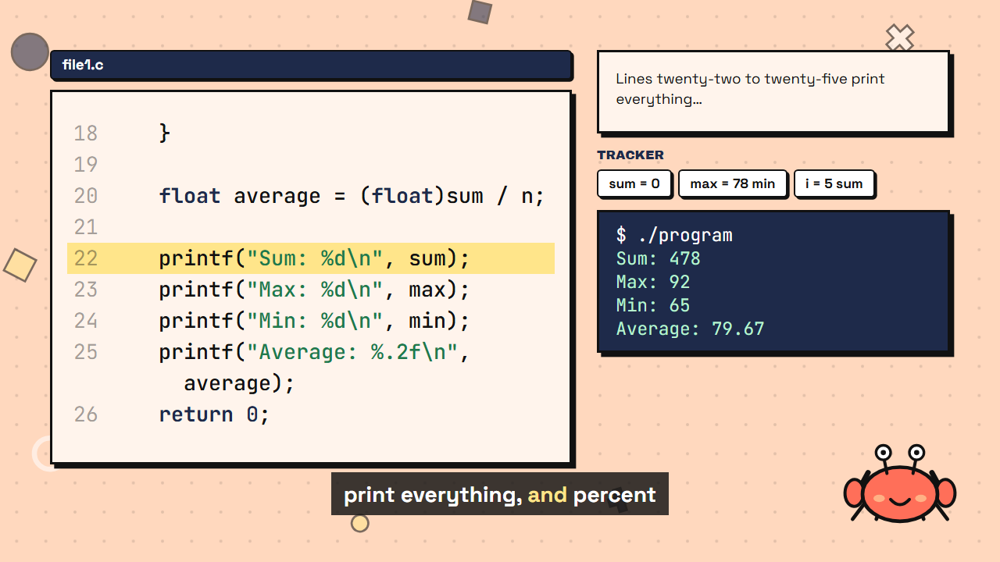 |
| EP45 card (fits at 28px, full text) | 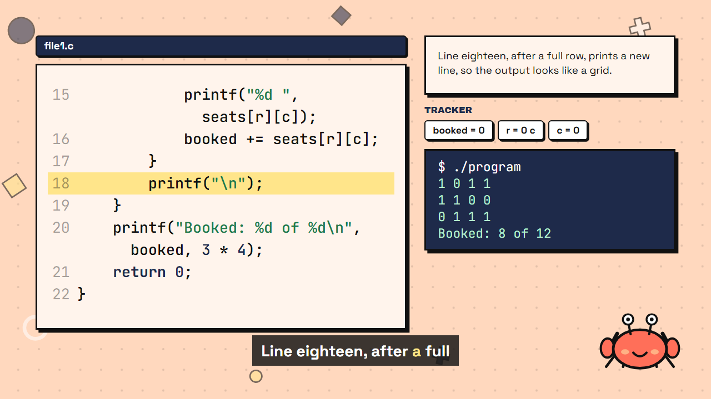 |
| EP49 card (28px, cut to its first clause) | 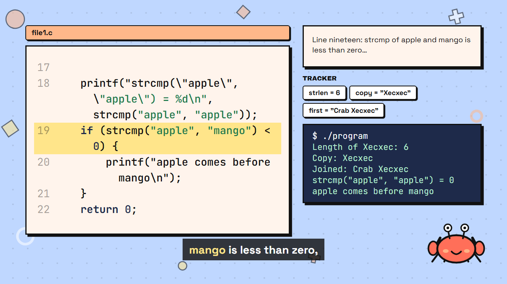 |
| EP7 MemoryBoxes with data still works | 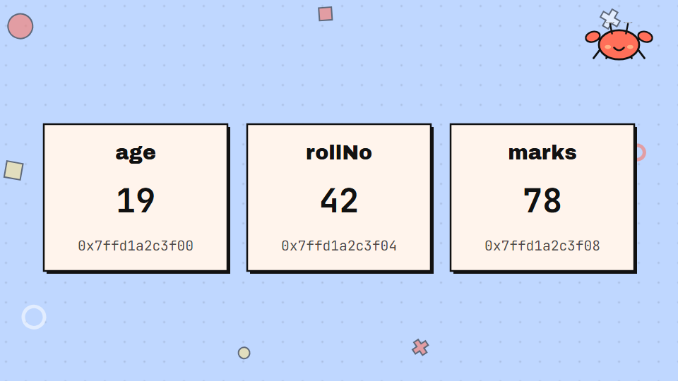 |

Seen in these stills: the EP10 fixed panel shows `FIXED: #define BUS_FARE 15 with no semicolon...` under code about `PI`. EP10 has two bug scenes (s8 `PI`, s9 `#define BUS_FARE`) but the episode has one `bug` record, so both scenes draw the same code and `why` mixes the two.
That is a data gap in EP10 (the second bug's wrong/fixed code is not in the JSON), not a layout bug.

### 15.3 Do the old EP1–19 masters have pass-4 defects? Yes, in every one: all 19 need the re-render

Proof by timestamp: every EP1–19 master was written between 3 Nov 04:49 UTC and 4 Nov 02:02 UTC (3 Nov 10:19 IST to 4 Nov 07:32 IST), before the pass-4 commits (Outro `2bfcf2c`, TitleCard `b7596ea`, BugOfTheDay `e38bc63` were authored 4 Nov 13:04–13:06 IST, the output layout `92a7255` 4 Nov 22:53 IST).
Proof by frame, from the old 4K files themselves: `docs/fix4/oldmaster-ep05-outro.png` (outro of EP5: "EP 06 · COMMENTS & CLEAN CODE; SIGN-OFF"), `oldmaster-ep12-outro.png`, and `oldmaster-ep03-bug.png`
(EP3's bug panel: seven lines of 22px text, where the new panel shows two lines at up to 44px).

| Episode | Master written (UTC) | Old outro shows | Bug panel: old -> new | Scenes with program output (old terminal layout) | Re-render |
|---|---|---|---|---|---|
| EP1 | 11-03 04:49 | ok | 9 lines at 22-28px -> 2 lines at 22-44px | 1 | yes |
| EP2 | 11-03 05:06 | ok | 4 lines at 22-28px -> 1 line at 22-44px | 0 | yes |
| EP3 | 11-03 05:24 | ok | 6 lines at 22-28px -> 2 lines at 22-44px | 0 | yes |
| EP4 | 11-03 05:41 | ok | 8 lines at 22-28px -> 2 lines at 22-44px | 3 | yes |
| EP5 | 11-03 06:00 | **COMMENTS & CLEAN CODE; SIGN-OFF** | 7 lines at 22-28px -> 1 line at 22-44px | 1 | yes |
| EP6 | 11-03 06:17 | **VARIABLES; SIGN-OFF** | 8 lines at 22-28px -> 2 lines at 22-44px | 1 | yes |
| EP7 | 11-03 06:35 | **DATA TYPES; SIGN-OFF** | 10 lines at 22-28px -> 2 lines at 22-44px | 3 | yes |
| EP8 | 11-03 06:54 | **MORE TYPES; SIGN-OFF** | 7 lines at 22-28px -> 2 lines at 22-44px | 1 | yes |
| EP9 | 11-03 15:37 | **CONSTANTS & #DEFINE; SIGN-OFF** | 7 lines at 22-28px -> 2 lines at 22-44px | 3 | yes |
| EP10 | 11-03 15:52 | **PRINTF DEEP DIVE; SIGN-OFF** | 5 lines at 22-28px -> 2 lines at 22-44px | 3 | yes |
| EP11 | 11-03 16:09 | **SCANF; SIGN-OFF** | 10 lines at 22-28px -> 2 lines at 22-44px | 2 | yes |
| EP12 | 11-03 16:26 | **TYPE CASTING; SIGN-OFF** | 16 lines at 22-28px -> 2 lines at 22-44px | 1 | yes |
| EP13 | 11-03 16:42 | **MINI PROJECT: UNIT CONVERTER; SIGN-OFF** | 2 lines at 22-28px -> 1 line at 22-44px | 5 | yes |
| EP14 | 11-03 17:02 | **MODULE 2 OPERATORS; SIGN-OFF** | 2 lines at 22-28px -> 1 line at 22-44px | 4 | yes |
| EP15 | 11-04 02:02 | ok | 5 lines at 22-28px -> 2 lines at 22-44px | 2 | yes |
| EP16 | 11-03 17:34 | ok | 3 lines at 22-28px -> 2 lines at 22-44px | 3 | yes |
| EP17 | 11-03 17:49 | ok | 2 lines at 22-28px -> 1 line at 22-44px | 2 | yes |
| EP18 | 11-03 18:09 | ok | 2 lines at 22-28px -> 1 line at 22-44px | 2 | yes |
| EP19 | 11-03 18:30 | **IF AND ELSE (MODULE 3: DECISIONS, MINT** | 2 lines at 22-28px -> 1 line at 22-44px | 3 | yes |

Even the episodes whose old outro was fine (EP1–4, 15–18) have the old small bug panel, and the ones with code scenes that print program output (EP1, 4, 15, 16, 17, 18; the counts are in the table) also have the old terminal strip, so none of EP1, 3, 4, 12, 17 can be proved clean:
EP1, 4, 17 have the old terminal strip and bug panel; EP3 has the old bug panel (7 lines of 22px text) and no program output; EP12 has the "; SIGN-OFF" outro and the 16-line bug panel.
Outro defects, by what the old master shows: EP5–14 print "; SIGN-OFF", EP14 prints "MODULE 2 OPERATORS" (the new table says ARITHMETIC OPERATORS), EP19 prints a garbled "IF AND ELSE (MODULE 3: DECISIONS, MINT…".
The old EP2 outro printed "SETTING UP VS CODE", the new one prints the episode title "SETTING UP"; I have not changed that.
**Conclusion: re-render all 19** (EP1–19 are one run; nothing is saved by leaving five out, and none of the five can be shown to be clean).

### 15.4 Shorts: which of the 430 involve memory-boxes or algorithm-bars scenes?

A Short never draws those scenes: `deriveShortVisuals` builds each Short's visual from its own data (`boxes` only when the source memory-boxes scene has `boxes`; there is no bars visual). So **no Short can render blank or crash**.
What happens instead: 68 Shorts have such a scene in `fromScenes`; in 54 of them the source scene has no data and the Short falls back to another visual: `text` 22, `code` 21, `quiz` 11, `analogy` 8, `boxes` 6 (the six with data: EP7 S1, EP8 S2, EP9 S2, EP12 S2, EP15 S2, EP17 S2; EP18 S5 has data and shows a quiz).
Once boxes data exists, the EP41–50 Shorts listed here would switch to the boxes visual, so those Shorts change in the 5b re-render too (EP41 S2 S5, EP44 S1 S2, EP45 S2 S5, EP46 S2 S5, EP47 S1 S2, EP48 S1, EP49 S5, EP50 S1 S2: 14 Shorts).
Per episode (Short -> source scene -> visual it gets now):

- **No data, fallback visual:** EP37 S1 (text) S5 (quiz); EP38 S2 (analogy); EP39 S2 (code); EP41 S2 (code) S5 (quiz); EP44 S1 S2 (code); EP45 S2 (code) S5 (quiz); EP46 S2 (code) S5 (quiz); EP47 S1 (text) S2 (code); EP48 S1 (text); EP49 S5 (quiz); EP50 S1 (text) S2 (code);
  EP52 S1 (text) S2 (code) S5 (quiz); EP53 S1 (text) S2 (code); EP54 S2 (text) S5 (quiz); EP55 S1 (code) S2 (text); EP56 S1 (text) S2 (code); EP57 S1 (text) S2 (code); EP58 S1 (analogy) S2 (text); EP59 S1 (analogy) S2 (text) S5 (quiz); EP60 S1 (code); EP62 S1 (text) S2 (code);
  EP64 S1 (code) S5 (quiz); EP65 S1 (text); EP66 S1 (analogy) S2 (analogy) S5 (quiz); EP67 S1 S2 (text); EP68 S1 (code) S2 (text); EP77 S2 (analogy); EP83 S2 (code); and the bars scenes with an empty trace: EP76 S2 (text), EP78 S2 (code), EP80 S2 (code), EP44 S1 also cites bars s1.
- **Bars scene has a trace (fine):** EP42 S2 (text), EP43 S1 (text) S2 (code), EP73 S2 (analogy), EP74 S2 (text), EP75 S2 (text), EP79 S2 (analogy).

### 15.5 Fix pass 5b, on paper: MemoryBoxes data for EP41–50

`node scripts/derive_boxes.mts` derives data for all 14 blank scenes with no hand-authoring (output: `docs/fix4/boxes-draft-ep41-50.json`; `episodes/*.json` untouched; nothing rendered).
Every value comes out of a C probe that is **compiled with `gcc -Wall -Wextra` and run** (GCC 6.3, MinGW, with `-D__USE_MINGW_ANSI_STDIO=1` so `%zu` is valid), built from the episode's own code samples, the scene's on-screen text and narration, and the challenge text, and is then cross-checked against the numbers the scene states.
All 14 compiled without warnings and all cross-checks passed.

| Scene | Layout | What it shows, and where the values come from |
|---|---|---|
| EP41 s4 | cells | `marks[5]` = 78 92 65 88 71, index under each box, badge "size 5, last index 4", from the scene 5 code |
| EP41 s7 | cells ×2 | `a[5] = {1, 2}` prints 1 2 0 0 0 (zero-filled cells flagged), `b[] = {4, 5, 6}` has size 3 (from sizeof), then the `b = a;` error and a copy loop |
| EP44 s4 | scalars, 3 steps | a = 10, b = 20 (from the narration) then `a = b;` then `b = a;`: both 20, the 10 lost |
| EP44 s5 | scalars, 4 steps | a, b, temp: `temp = a; a = b; b = temp;` ends with a = 20, b = 10 |
| EP45 s4 | grid 3×4 + flat | `seats` values from the scene 5 code; the row-major flat order is checked to equal memory order; sizeof = 48 |
| EP45 s7 | matrices | a = {1 2 3, 4 5 6}, b = {6 5 4, 3 2 1} (challenge text), sum = all 7 (the challenge says "all sevens") |
| EP46 s4 | cells + byte ruler | `marks[5]`, sizeof 20, element 4, n = 5: all three equal the numbers on the scene |
| EP46 s7 | alias | main's `marks` and the function's `arr` are one row; `addBonus` from the sample code is run so before/after cells are real |
| EP47 s3 | cells | `char word[6]` = G O A N S `\0`, from the quoted characters on screen |
| EP47 s4 | cells | "Panjim" = 7 boxes, last `\0` (stop sign); the on-screen count 7 matches sizeof |
| EP48 s3 | buffer | "Atreya Kamat\n": `sscanf("%s")` really consumes 6 characters and leaves " Kamat\n" |
| EP49 s4 | cells | "Xecxec": strlen 6, sizeof 7 (the narration's numbers) |
| EP49 s5 | strings, steps | the sample's `strcpy`/`strcat` statements executed: copy "Xecxec", first "Crab " then "Crab Xecxec" (the program's own output says "Joined: Crab Xecxec") |
| EP50 s3 | mirror | "feni" over `rev`: arrows pair i with len − 1 − i; the reverse loop is run and its result "inef" is checked against the reversed word |

**The component is the larger job, not the data.** Today's `MemoryBoxes` draws only one row of up to about 6 name/value/address boxes, 260px minimum each (7 boxes overflow the 1728px content width), no index row, no grid, no steps, no byte ruler, no arrows between rows.
So 5b needs a `cells` layout (index under each box, grey zero fill, `\0` stop sign, byte ruler, steps, alias arrows), a `grid`, `scalars` with steps, and `matrices`; the data above maps onto those. The 43 blank scenes of EP52–83 need the same generator extended to pointers and structs.
Nothing is hand-authored so far; if the generator cannot derive a scene for EP52+, I will list it before authoring.

### 15.6 Re-render list after 5a (unchanged from section 14, now with proof)

EP1–19: all 19 (see 15.3). EP41–50: all 10 (bug window; card overflow in 41–45, 47–50; raw TRACK text in EP43; blank memory-boxes in 41, 44–50; Shorts change for 14 of them after 5b).
EP20–40 and EP51–86 have no 4K masters, so these fixes only have to be in place before their first render; `check_scenes` now blocks the ones that would still be blank or crash (EP37+).

## 16. EP10 second bug, no ligatures in code, card uses the space below the output panel

### 16.1 EP10 bonus bug authored; the same pattern elsewhere: none

EP10 has two Bug of the Day scenes (s8 `PI`, s9 `#define BUS_FARE 15;`) but the JSON had one `bug` record, whose `why` was the second bug's text. Now:
the schema gives a scene an optional `bug` record (`src/lib/episode.ts`), `scenePropsFor` uses `scene.bug ?? episode.bug`, `episodes/ep010.json` has the bonus bug on scene 9 (wrong code, the GCC error and notes, fixed code, `Fix:` line, all from `docs/bible/m01.md`, EP 10), and the main record's `why` is now its own sentence
("A `const` variable is read-only after it is initialised, so any later assignment is a compile error.").
GCC check (GCC 6.3, MinGW): the `PI` program fails with `error: assignment of read-only variable 'PI'` and the fixed one prints `PI: 3.14`; the bonus program fails with `bonus10.c:2:20: error: expected ')' before ';' token` and `note: in expansion of macro 'BUS_FARE'`, the fixed one prints `Bus cost: Rs 60`.
The Bible's extra note `to match this '('` comes from a newer GCC than the local one, so it is in the data but the panel only shows the first diagnostic and its source line.

`node scripts/scan_bug_records.mts` (counts Bug of the Day scenes, scene-level records, the Bible's scene-table rows and "Bonus bug" blocks for all 86 episodes): **EP10 was the only one** (87 bug scenes = 86 + this one). Now every bug scene has its own record and the counts match the Bible.
`bug_windows.mts` and `bug_excerpts.mts` now check both EP10 bugs: culprit visible in both windows (0 misses), excerpts correct.

| Panel | Still |
|---|---|
| EP10 s8 wrong: `PI = 3.0f;` highlighted | 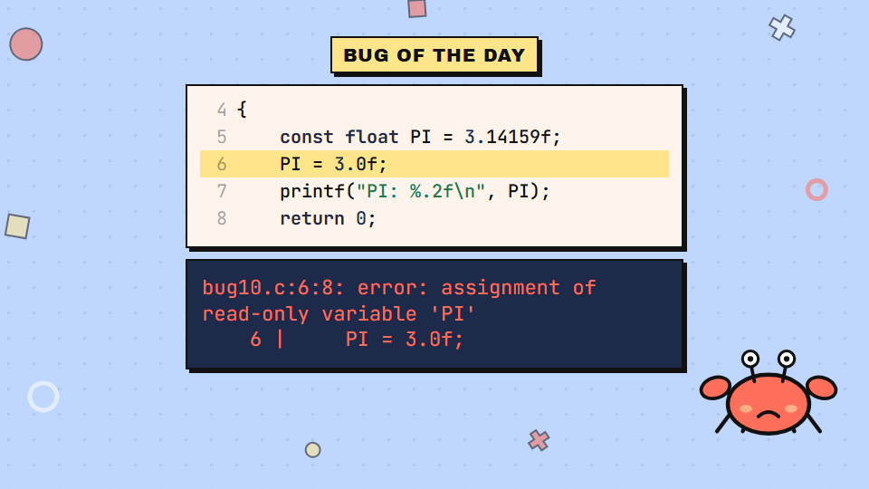 |
| EP10 s8 fixed, now with its own explanation | 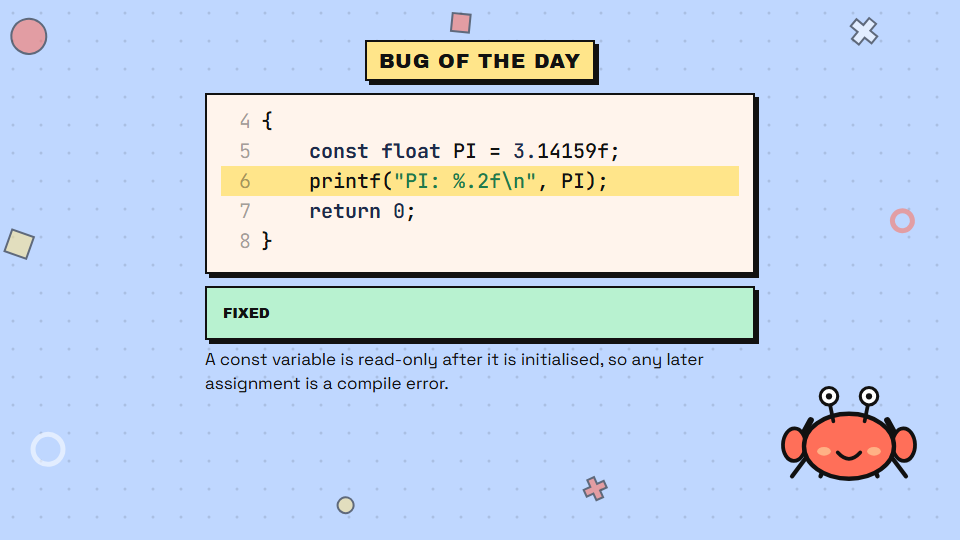 |
| EP10 s9 wrong: `#define BUS_FARE 15;` highlighted, GCC error | 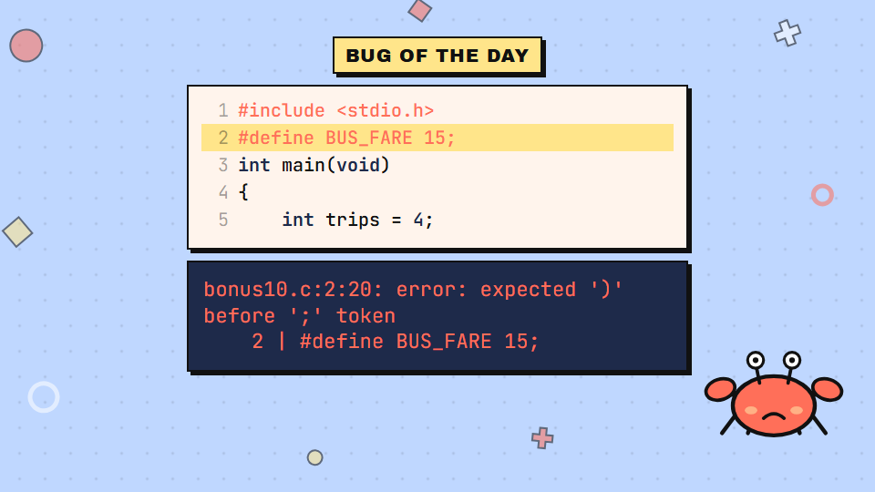 |
| EP10 s9 fixed: the line without the semicolon | 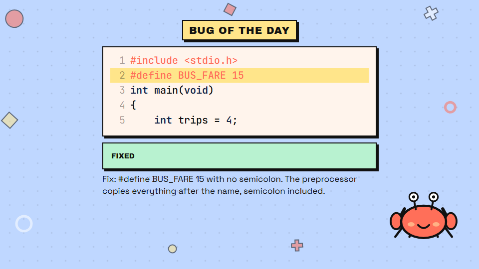 |

### 16.2 Ligatures off in every code face

`src/theme/fonts.ts`: every font face loads with `featureSettings: '"liga" 0, "calt" 0'`, and a global rule `*, *::before, *::after { font-variant-ligatures: none; font-feature-settings: "liga" 0, "calt" 0 }` is added to the composition,
so CodeBlock, CodeExplain (code, output panel, tracker), BugOfTheDay, Terminal, MemoryBoxes, AlgorithmBars and the Short visuals all get it, including SVG text.
Before, `<=` was drawn as a single "less-or-equal" glyph and `!=` as "not equal" (visible in the old EP41 bug panel and the EP41–50 masters). Now:

| Frame | Still |
|---|---|
| EP41 bug panel: `i <= 5` is plain ASCII `<=` |  |
| EP50 s6: `!=` (line 25) and `==` (line 27) as typed | 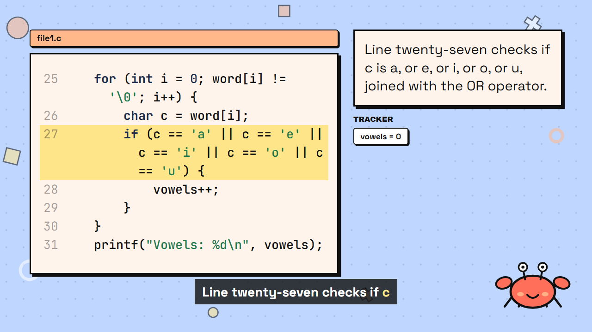 |
| EP48 s5: `!= '\n'` (line 12) | 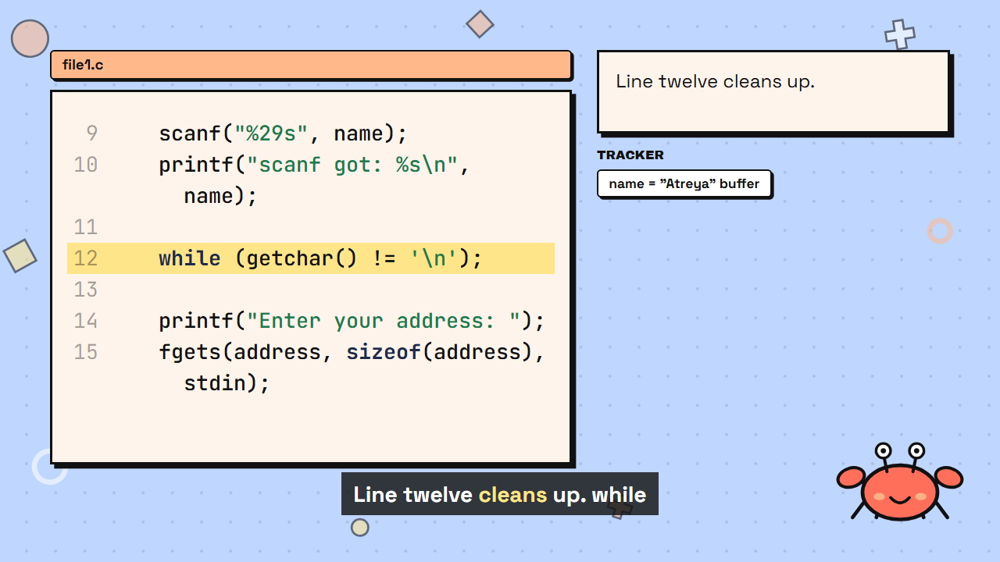 |

(EP48 has no `strcmp`; `strcmp` is in EP49 s7. The frames with both `!=` and `==` are in EP50, and `!=` alone is in EP47 s5 and EP48 s5.) **Every master rendered before this change shows the old glyphs in its code panels, so all EP1–19 and EP41–50 masters need the re-render, which they already do.**

### 16.3 Explanation card uses the space below the output panel

In scenes with program output the right column now runs to y 790 in every scene (it stopped at 700 outside takeover), so the card can take what the output panel leaves.
The scene still picks takeover by the old room rule, so the takeover set is unchanged. Xecxec's "It runs!" bubble is dropped when the layout reaches below the old y 700 line (as in takeover).
Result (`scripts/scan_label_overflow.mts`): font size per scene 44px **81** (was 49), 40px 14, 36px 12, 32px 5, 28px 35 (was 57); labels cut to their first clause **13 in 10 episodes** (was 32 in 20): EP14, 25, 47, 49, 52, 61, 66, 81, 83, 84.
EP42 is no longer cut; the EP50 frame above shows a 3-row card at 44px with the full text and the tracker below it.
