# Fix pass 4 — report

## 1. Code-explain scenes with no `code`

The laptop branch `fix/ep26-32-code` (50c59a4, 8979e97, 65d6ff4) already had `scripts/add_scene_code.mts` and the code for
EP26 and EP28–32. Fix pass 4 is rebased onto it, and no second script was written. The laptop data for EP26 and EP28–32 is
used as is (re-running the script on them changes nothing).

**What I extended in the laptop script** (it could not handle these cases):
- It only read `docs/bible/m04.md`. It now finds the module file that holds the "## EP n" heading, and it reads CRLF
  module files (m06 is one).
- It paired Bible code blocks with scenes by position and skipped an episode when the counts differed. A target can now have
  `pick: [..]`, the 1-based Bible pair each scene shows (EP41, 44, 59, 61 and 71 have more programs than target scenes;
  EP71 shows `binread.c` twice).
- The file name is also read when it is bare at the start of the onScreen text ("ep41_arrays.c types itself"), and a target
  can give `names` for a scene that names no file (EP61 scene 7 → `ep61copy.c`).

Result for the 12 scenes added in this pass: a deep-equal against `HEAD` shows only `scene.code` changed in the 7 files, every
source compiles with `gcc -Wall -Wextra`, and the sources and outputs are identical to my own earlier mapping.

The scan of EP20–86 for code-explain scenes without code found the list in the brief plus EP59 s5, EP61 s7, EP69 s6/s9,
EP70 s4/s6 and EP71 s4/s5/s7/s8. Nothing else.

| Episode | Scene | File shown | Source | Done by |
|---|---|---|---|---|
| EP26 | 5, 8 | `sorry.c`, `double.c` | Code shown, blocks 1, 2 | laptop |
| EP28 | 1 | `ep27_table7.c` | EP27 challenge answer, wrapped in `main` | laptop |
| EP28 | 3, 4, 6 | `once.c`, `dowhile.c`, `menu.c` | Code shown, blocks 1–3 | laptop |
| EP29 | 5, 8 | `brk.c`, `skip3.c` | Code shown, blocks 1, 2 | laptop |
| EP30 | 4, 6 | `nested.c`, `times.c` | Code shown, blocks 1, 2 | laptop |
| EP31 | 4, 5, 7 | `tri.c`, `invtri.c`, `rt4.c` | Code shown, blocks 1–3 | laptop |
| EP32 | 4, 5, 7 | `pyr.c`, `diamond.c`, `floyd.c` | Code shown, blocks 1–3 | laptop |
| EP41 | 5 | `ep41_arrays.c` | Code shown, block 1 | this pass |
| EP44 | 6 | `ep44_swap.c` | Code shown, block 1 (narration walks lines 4–25: swap plus one bubble pass) | this pass |
| EP59 | 5 | `double.c` | Code shown, block 1 | this pass |
| EP61 | 7 | `ep61copy.c` | Code shown, block 2 | this pass |
| EP69 | 6, 9 | `write.c`, `append.c` | Code shown, blocks 1, 2 | this pass |
| EP70 | 4, 6 | `readlines.c`, `marks.c` | Code shown, blocks 1, 2 | this pass |
| EP71 | 4, 5, 7, 8 | `binwrite.c`, `binread.c` (x2), `update.c` | Code shown, blocks 1, 2, 2, 3 (the two `binread.c` scenes show lines 1–22 and 24–32; the panel holds the whole file) | this pass |

### Pick list: which Bible block each scene shows, and the narration it matches

Used where the Bible's "Code shown" has more programs than target scenes (`pick` in `scripts/add_scene_code.mts`).
"Block" is the Nth code block (with its output block) in the episode's "### Code shown". The narration column quotes the
line cue in the scene's narration and the matching line of the chosen block.

| Episode | Scene | Block | File shown | Narration line it matches | Other blocks (used elsewhere) |
|---|---|---|---|---|---|
| EP41 | 5 | 1 of 4 | `ep41_arrays.c` | "Line four creates the array and fills it in one go" ↔ line 4 `int marks[5] = {78, 92, 65, 88, 71};` | 2–4: the other array examples (initialisers, `b = a`) |
| EP44 | 6 | 1 of 2 | `ep44_swap.c` | "Line eight, a is 10, b is 20 … Line nine, temp equals a … Line fifteen, a loop … i < n − 1" ↔ lines 8, 9, 15 | 2: the wrong `a = b; b = a;` swap shown in scene 4 |
| EP59 | 5 | 1 of 2 | `double.c` | "Line 4: bus equals 42. Line 5: p points to bus. Line 6: int star star pp" ↔ lines 4–6 | 2: `bigger.c` (a later scene) |
| EP61 | 7 | 2 of 2 | `ep61copy.c` | "Write struct Student s3 equals s1, and every member is copied" ↔ line 11 `struct Student s3 = s1;` | 1: `ep61.c` (scene 4, already had it) |
| EP71 | 4 | 1 of 3 | `binwrite.c` | "an array of 3 students, filled in … fwrite" ↔ line 16 `fopen("students.dat", "wb")` | |
| EP71 | 5 | 2 of 3 | `binread.c` | "fopen with "rb" … while fread" ↔ line 10 `fopen("students.dat", "rb")` | |
| EP71 | 7 | 2 of 3 | `binread.c` | "Every record is 28 bytes … fseek … ftell" ↔ lines 27–28 `fseek(fp, 0, SEEK_END); … ftell(fp)` (same program as scene 5) | |
| EP71 | 8 | 3 of 3 | `update.c` | "fopen with "r plus b" … changing one record" ↔ line 10 `fopen(…, "r+b")`, line 19 `fseek(fp, pos, SEEK_SET)` | |

EP69 (scenes 6, 9) and EP70 (scenes 4, 6) need no pick: their scene file names (`write.c`, `append.c`, `readlines.c`, `marks.c`)
pair one to one with the two blocks in each Bible section, and EP41/44/59/61/71 above are the only episodes where the
block count and scene count differ.

### `check_c.py` for the episodes changed in this pass

| Episode | PASS | Non-PASS | Cause |
|---|---|---|---|
| EP41 | 5 | `file3.c` COMPILE-ERROR | Deliberate: `b = a;` on arrays is the lesson. Expected. |
| EP44 | 4 | none | |
| EP59 | 4 | none | |
| EP61 | 4 | none | |
| EP69 | 4 | none | |
| EP70 | 2 | `file1.c`, `file2.c` OUTPUT-MISMATCH (empty output) | They read `diary.txt` / `marks.txt`, made by earlier programs; the checker runs each file alone. |
| EP71 | 3 | `file2.c`, `file3.c` OUTPUT-MISMATCH (empty output) | They read `students.dat` made by `binwrite.c`. Same limit. |

No failure is a fault in the added code. I ran the chains by hand in a scratch folder: EP69 `write.c` + `append.c` →
EP70 `readlines.c`; a 3-line `marks.txt` → EP70 `marks.c`; EP71 `binwrite.c` → `binread.c` → `update.c`. Every output matches the Bible.
EP26–32 were checked by the laptop; earlier runs here gave: EP26 `wrong.c` TIMEOUT (deliberate infinite loop), EP28
`menu.c` TIMEOUT (needs typed input), EP29–32 all PASS. `docs/c-check-summary.md` is regenerated by the tool and is left uncommitted.

## 2. Outro: why the next-episode title was dropped

`sceneProps.ts` parsed the Bible's outro line with `/EP\s*(\d+)\s*[·-]\s*(.+?)…/`. It only matched
"Next: EP 43 · Title" (a `·` or `-` between number and title). The Bible has many other wordings, for example
"Next: EP 43 Searching" (EP41–50 mostly), "Next: EP 27, the for loop", "Module 6 complete; next: EP 47 Strings",
"Next: Module 8 Pointers, EP 52", and "Next: EP 34" with no title at all. Any miss fell through to the literal
"Next episode", which rendered as "EP 43 · NEXT EPISODE".

Fix: the next episode is always `ep + 1` (checked against all 85 outro lines: every wording names `ep + 1`).
Its title now comes from `src/lib/episodeTitles.ts`, generated by `scripts/gen_episode_titles.mts` from each
episode's title card ("EP 43 · SEARCHING"). All 86 title cards parse. The component picks 76px or 64px for long
titles. EP86 has no next episode, so its card says "Thank you / 86 episodes. You did it."

## 3. TitleCard: long titles over Xecxec

The title card shows the full episode title (up to 51 characters, for example EP50's
"String Manipulation: Is "malayalam" a Palindrome?"). At a fixed 128px it needed 3–4 lines and ran into the mascot
(bottom right, top edge near y = 610). `src/lib/titleFit.ts` now steps the size down (128 → 72px) until the title
fits a box of 1555x360, and the title block is centred in the area above the mascot (padding 200 / 96 / 420).
All 86 titles fit. The worst is EP50 at 96px on 3 lines; 24 titles use a size below 128. A 720p still of EP50 confirms
it: three lines, clear of Xecxec.

## 4. EP43 search scenes

`scripts/add_search_highlights.mts` adds, to the EP43 `trace` entries only, `compare: [i, i]` (the Bible's "Compared"
column names the box) and, on the step that finds the value, `sorted: [i]`. `AlgorithmBars` already paints compare
in butter and sorted in mint, so no component change was needed. Linear search checks boxes 0–5 and box 5 turns mint;
binary search checks box 3, then box 5 (mint). Verified: apart from `trace`, the file is identical to `HEAD`.

Not done (flagged): the Bible says the discarded half greys out in binary search ("bars 0–3 grey"). The trace has no
field for it. The "Swaps: 0" and "Pass N" chips also still show on search scenes.

## 5. BugOfTheDay error panel

`src/lib/errorExcerpt.ts` picks at most two lines of the Bible's error text. For GCC diagnostics: the first
`error:`/`warning:` line plus the echoed source line. For "no error, wrong output" bugs: the **last** two lines of the
output block (the wrong value is usually at the end, for example EP41's `marks[5] = 32767`), not the first two,
because the first two would show only correct values. The prose lead-in ("GCC gives no error ...") is never shown.
Font size now goes up to 44px (it was 28px at most) and long lines wrap.

## 6. Short cards with tiny content

Cause for EP43 S1: the bits visual matched the bare digits "1000" in "1000 NAMES → 10 STEPS" and drew the
binary number 10 in a small card. The same false positive hit EP23 S1 ("1, 2 or 3?" read as "2 OR 3"). Both fixed
in `shortVisual.ts` (word operators must be capitals, bare 0/1 runs no longer count). Across all 430 Shorts only these
two visuals changed: EP23 S1 now shows the beach-shack menu analogy, and EP43 S1 is a text card. Text cards already
scale to fill (56–140px). The terminal card (EP04 S1, EP69 S1) now fits its font to the slot (40–80px, was 40/48px).

## 7. Outro check for EP1–86

`node scripts/check_outro_titles.mts` runs the real `scenePropsFor` for every episode and prints the outro line from the
Bible next to the next-episode number and title the Outro receives. It exits 1 if any title is missing or the number named in
the Bible line differs. Result: **all 86 outros show a title**. Both families the laptop review saw are covered:

| Bible wording | Episodes | Shown |
|---|---|---|
| "Next: EP 21 else-if ladders; sign-off" (no `·`; also "Next: EP 27, the for loop", "Next: EP 34", "… and Next: EP 29") | EP20–34 | `EP 21 · ELSE-IF LADDERS`, `EP 27 · THE FOR LOOP`, `EP 34 · WHAT ARE FUNCTIONS?` |
| "Next: EP 35 · Parameters & return values" (with `·`) | EP34–40, EP1–19 | `EP 35 · PARAMETERS & RETURN VALUES` |
| "Next: EP 43 Searching" (EP41–50), "Module 6 complete; next: EP 47 Strings", "Next: Module 8 Pointers, EP 52" | EP41–83 | `EP 43 · SEARCHING`, `EP 47 · STRINGS` |
| EP86: thank-you card, no next episode | EP86 | "Thank you / 86 episodes. You did it." |

Before the fix only the `·` form worked, so EP20–33 and EP41–51 and others lost the title; the laptop saw it from EP35 on
because EP34–40 use the `·` form. The full list (86 lines) is the output of the script.

## 8. Terminal strip and title cards (checked at 540p)

- **Terminal strip beside the explanation card (EP20, EP25).** The program-output panel was sized for 306px of height. EP20's
  output has 11 lines and EP25's has 14, which needed 24px type and still overflowed. `src/lib/outputFit.ts` now picks the size
  (34 → 26px). If the output cannot reach 28px under the explanation card and tracker (142 outputs in EP1–86: 97 stay in the
  normal slot, 45 do not), the terminal takes the whole right column once it starts printing (the last 22% of the scene)
  and the explanation card and tracker step aside. The worst cases (EP21: 17 lines, EP28: 24 lines) are cut with "…" at 26px.
- **EP31 and EP32 titles.** With the current `titleFit` both titles (2 and 3 lines) stay clear of Xecxec: 540p stills of the
  title card for EP31, EP32 and EP51 (and a 720p still of EP50) checked by eye. The laptop review may have been of a render made before the
  TitleCard commit. No further change was needed.

## 9. Follow-ups after review

**EP71 scene 4: highlight on `fwrite`, not `fopen`.** Confirmed from the narration cues of `binwrite.c`: `[HL 16]` ("fopen,
students dot dat, wb. The b means binary") lands on line 16, the `fopen` line, with its own sentence; `[HL 17]` is the NULL
check; `[HL 22]` ("size_t written equals fwrite, s, sizeof struct Student, 3, fp. fwrite takes four things …") lands on line 22,
the `fwrite` line, and its explanation sits under that cue. `[HL 23]` is `fclose`. (In the pick-list table above, line 16 is
the `fopen` line the scene passes first; the `fwrite` call is line 22.)

**EP43 search scenes: chips.** `AlgorithmBars` now shows "Pass N" only when the trace has pass labels ("1.2"), and a trace with
neither passes nor swaps shows "Checks: n" and no "Swaps" chip. Affected traces: EP42 scene 4 (max/min), EP43 scenes 3 and 5
(linear and binary search), EP73 scenes 3 and 4. Sorting traces (EP44, EP74, EP75, EP79) are unchanged.

**Long terminal output: what is cut.** The font now goes down to 22px before anything is cut. Across EP1–86 (142 program
outputs) exactly one scene still does not fit: **EP28 scene 6 (`menu.c`, 24 lines)** drops its first 8 lines and keeps the last
16, with "…" on top. The 8 dropped lines are: an empty line, then `1. Check balance`, `2. Add 100`, `3. Exit`, `Choice: 1`,
`Balance: 500`, an empty line and `1. Check balance`. This is the first round of the menu; the rounds shown still include the
full menu twice, `Added! Balance: 600`, `Invalid choice` and `Bye!`. EP21 scene 4 has 17 lines and now fits whole, at 22px. The
long ones that fit without cutting: EP20 (11 lines, 34px), EP22 (10, 28px), EP24 and EP25 (14, 26px), EP83 (14, 26px).

Real-props stills at 540p (props from `scenePropsFor` on the real episode JSON; EP21 and EP28 have no narration on this PC, so
the highlight cues are the defaults and the highlighted line is not the narrated one):

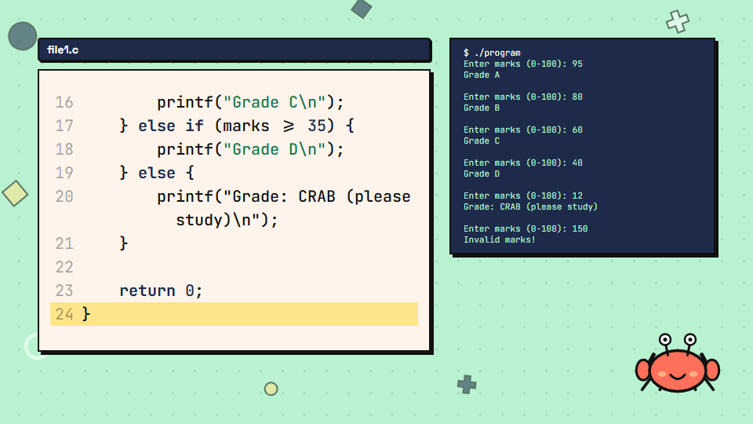
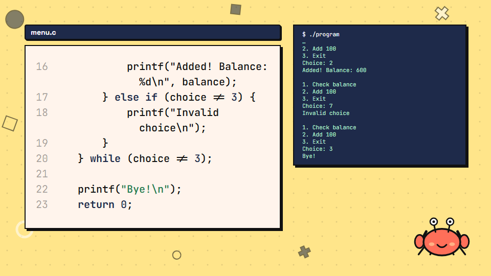

## 10. EP41–50 540p drafts after fix pass 4

Re-rendered with all fix-pass-4 changes (queue order EP42–50, then EP41; one job at a time, `--scale=0.5`, `out/draft540`; the first-round drafts are kept in `out/old540`). All 60 files (10 long, 50 Shorts) are DONE, with no black frames, loudness −16.0 LUFS, and long-video true peak between −1.64 and −1.71 dBTP (Shorts −3.4 to −4.1 dBTP). **PROVISIONAL: checked by the automatic rules and a look at the EP43 contact sheet; the other sheets are not reviewed.**

| Episode | Long video time | Size | LUFS | True peak | Shorts | Worst Short true peak | Result |
|---|---|---|---|---|---|---|---|
| EP41 | 4m09s | 26.1 MB | -15.99 | -1.69 dBTP | 5 | -3.76 dBTP | PASS |
| EP42 | 3m44s | 23.7 MB | -16 | -1.67 dBTP | 5 | -3.85 dBTP | PASS |
| EP43 | 4m11s | 26.1 MB | -16.01 | -1.68 dBTP | 5 | -3.93 dBTP | PASS |
| EP44 | 4m03s | 25.1 MB | -16 | -1.69 dBTP | 5 | -3.92 dBTP | PASS |
| EP45 | 3m15s | 21.0 MB | -15.99 | -1.71 dBTP | 5 | -3.88 dBTP | PASS |
| EP46 | 3m39s | 23.8 MB | -15.99 | -1.66 dBTP | 5 | -3.38 dBTP | PASS |
| EP47 | 3m33s | 23.2 MB | -16 | -1.67 dBTP | 5 | -3.92 dBTP | PASS |
| EP48 | 3m40s | 24.9 MB | -16 | -1.71 dBTP | 5 | -3.79 dBTP | PASS |
| EP49 | 3m57s | 26.6 MB | -16 | -1.68 dBTP | 5 | -3.89 dBTP | PASS |
| EP50 | 3m45s | 25.0 MB | -15.99 | -1.64 dBTP | 5 | -3.81 dBTP | PASS |

Contact sheets: `out/draft540/epNNN/*.sheet.png`. EP43 sheet shows the Checks chip, the moving butter box, the mint found box and the two-line bug panel.

## 11. Terminal takeover: wider, taller, larger type (follow-up)

Laptop frames showed the takeover panel at about 36% of the width and 45% of the height with the lower half empty and type
near 22px. Changes (`src/lib/outputFit.ts`, `src/scenes/CodeExplain.tsx`):

- **Width.** When an output takes over the right column, the code panel is narrower for the whole scene (870px, was 1002px; no
  reflow mid-scene) and the terminal is 810px wide, 42.2% of the 1920px frame (was 678px, 35%).
- **Height.** The panel stretches over the full column, y 96 to 790 (694px, 64% of the frame; was content-sized at about 486px).
  Xecxec's "It runs!" bubble is not shown in takeover mode, because it would sit on the panel's bottom edge.
- **Type.** Takeover sizes are 30, 28, 26 and 24px (minimum 24, was 22). The largest that fits is used. "…" with the last lines kept
  applies only if 24px does not fit. The normal slot (short outputs under the explanation card) is unchanged.
- **Result over EP1–86** (the 45 takeover outputs): 43 at 30px, EP21 s4 at 26px with nothing cut, EP28 s6 at 24px, and **only EP28 scene 6
  is cut**: 24px, the first 6 of its 23 lines dropped (a blank line, the first menu `1. Check balance / 2. Add 100 / 3. Exit`,
  `Choice: 1`, `Balance: 500`); "…" is shown on top and the last 17 lines are kept.

540p stills of the real props, at the end of each scene (`docs/fix4/takeover-*.png`):

| Scene | Lines | Size | Cut | Still |
|---|---|---|---|---|
| EP20 s4 | 11 | 30px | none | 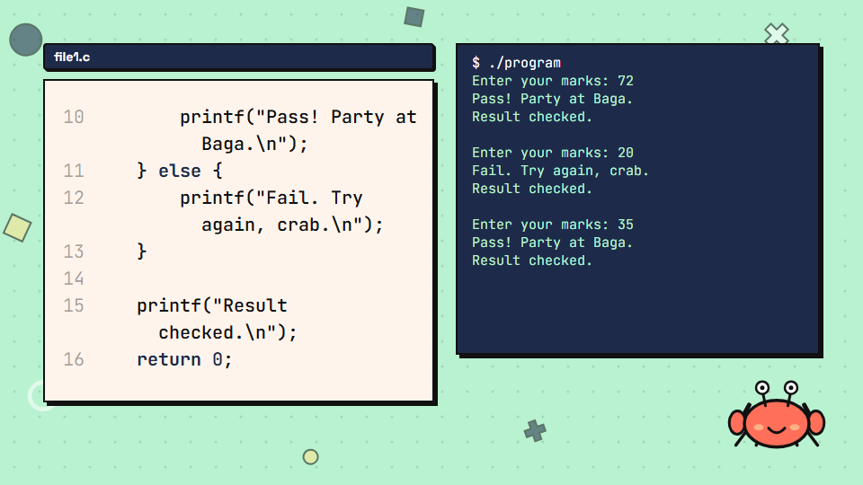 |
| EP21 s4 | 17 | 26px | none (was 2 cut) | 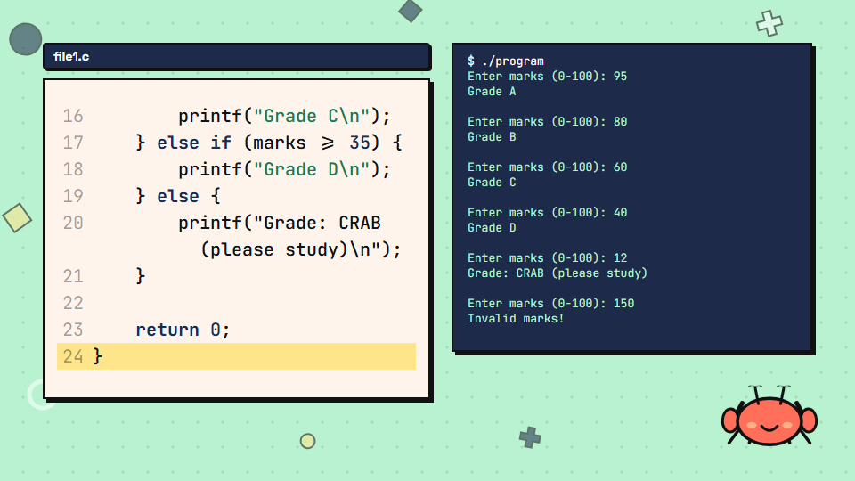 |
| EP25 s4 | 14 | 30px | none | 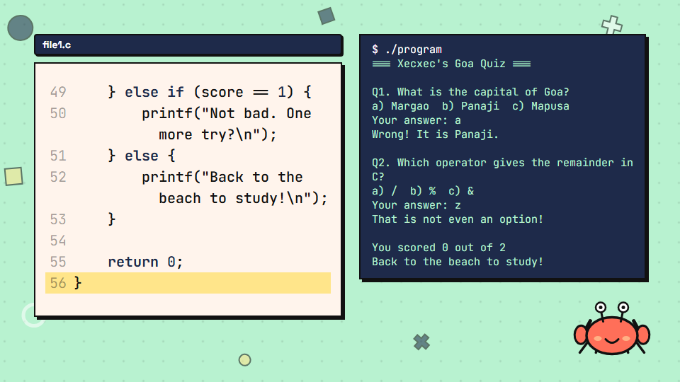 |
| EP28 s6 | 23 | 24px | first 6 lines | 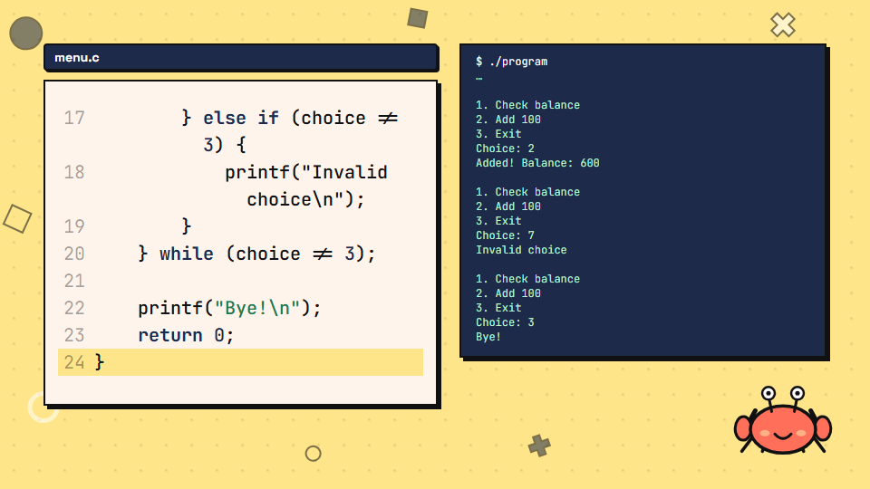 |
| EP83 s5 (other long output) | 14 | 30px | none | 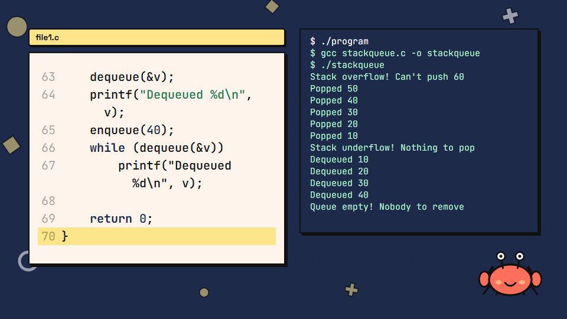 |

Nothing was re-rendered. Which episodes pick this up is for you to say. Takeover scenes exist in EP8, 9, 11, 14, 16, 20–22, 24, 25, 27–29,
32, 41, 47, 51, 52, 56, 61, 64, 65, 72, 74–77, 81, 83 and 84.

## 12. Bug of the Day panels: excerpt rules (branch `fix/bug-excerpts`, not merged yet)

`src/lib/errorExcerpt.ts` now classifies the Bible's "error" text instead of taking the second block blindly.
`node scripts/bug_excerpts.mts --old=<old errorExcerpt.ts>` prints the panel text for all 86 episodes and marks changes.

| Rule | Shows | Episodes that use it |
|---|---|---|
| diagnostic | the `file:line:col: error/warning: text` line + the echoed source line (a bare heading like "GCC error:" no longer counts) | EP1, 4, 6–12, 15, 20, 22–24, 28, 34–37, 39, 44, 46, 49, 51–58, 60–63, 68, 77, 81, 82, 86 (EP36 changed) |
| myth | the first numbered proof; the quoted claim is added above it only if the code card does not already show it (compared after normalising quotes) | EP2 (changed) |
| output | the last two lines of the program-output block, skipping shell commands and prose lead-ins | the rest; EP5 changed |
| crash | prose-only text that names a crash: that message | EP59, 65, 69, 79 (changed) |
| override | hand-written table `src/lib/bugOverrides.ts` | EP67, EP73 (changed) |

**Only nine episodes change: EP2, 5, 36, 59, 65, 67, 69, 73, 79.** The other 77 are identical to the old output (checked by the script). Outside
EP1–19: EP36, 59, 65, 67, 69, 73, 79; none are in EP41–50. Nothing is flagged prose-only any more.

540p stills of the nine panels (real props, taken at 60% of the scene, while the error is on screen):

| Episode | Panel text | Still |
|---|---|---|
| EP2 s8 | only the proof line (the claim is already in the card above) | 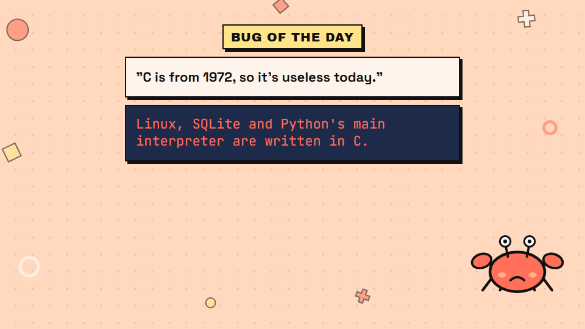 |
| EP5 s9 | `Namaskar, Goa!` (the old exe's wrong output) | 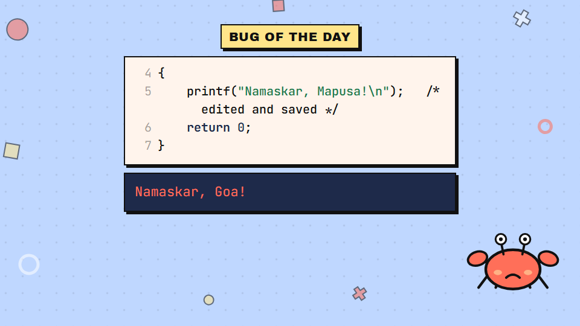 |
| EP36 | the real GCC error + source line (was "GCC error:") | 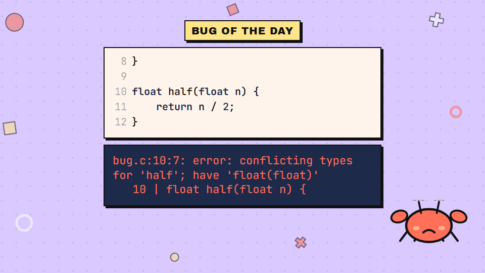 |
| EP59 | `Segmentation fault` | 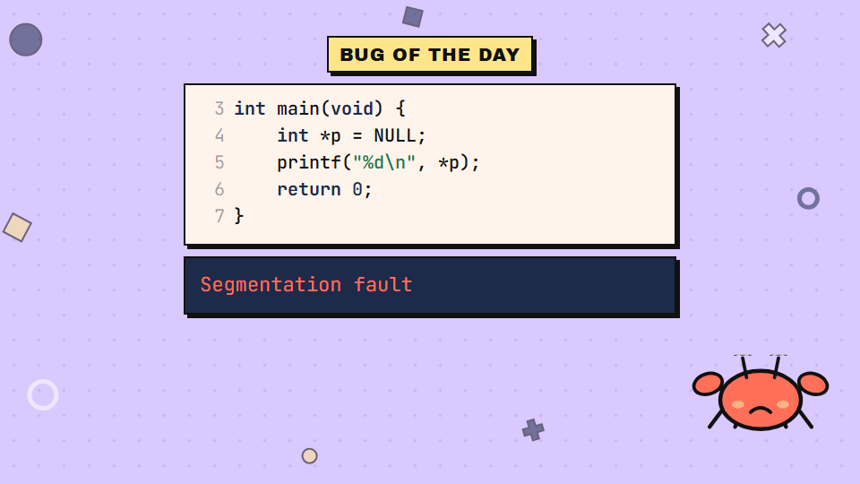 |
| EP65 | `Segmentation fault` | 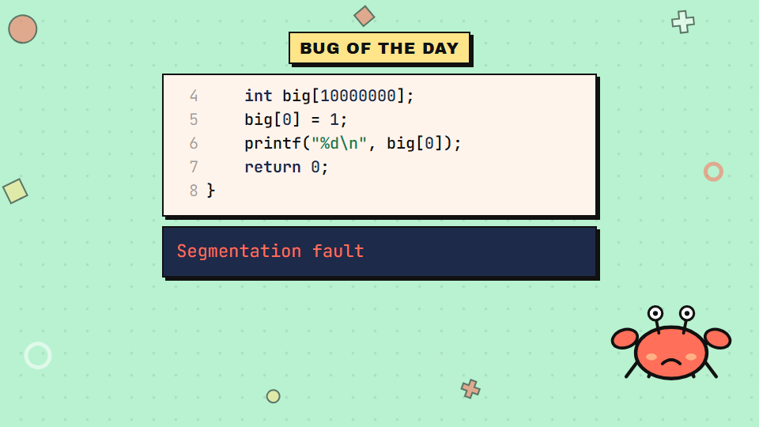 |
| EP67 | override: `realloc returns NULL and overwrites basket` | 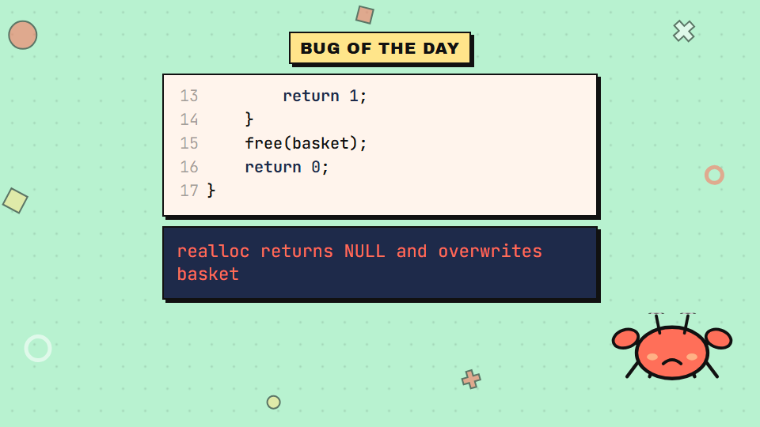 |
| EP69 | `Segmentation fault` | 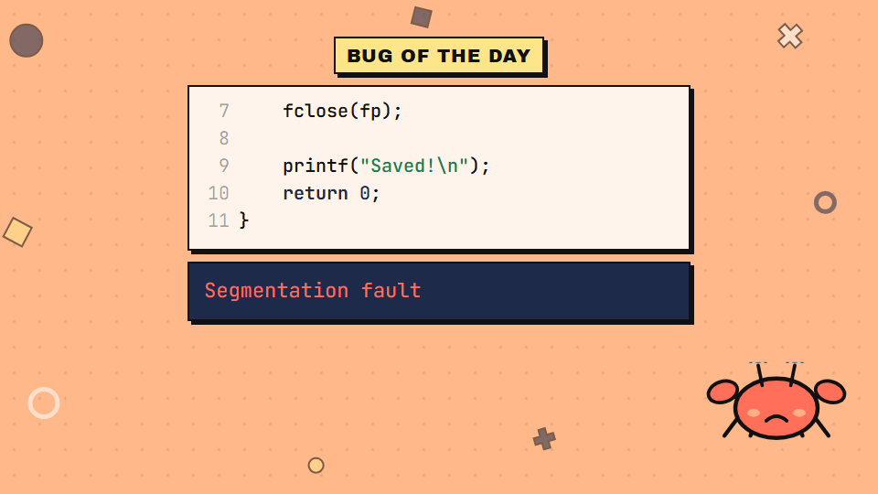 |
| EP73 | override: `$ ./program`, blinking cursor, `^C`, caption "no output, program hangs" (cursor is in its "on" half in this frame) | 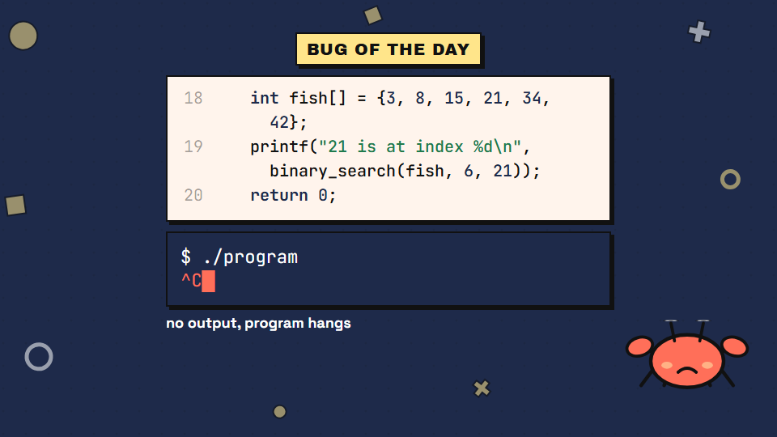 |
| EP79 | `Segmentation fault` | 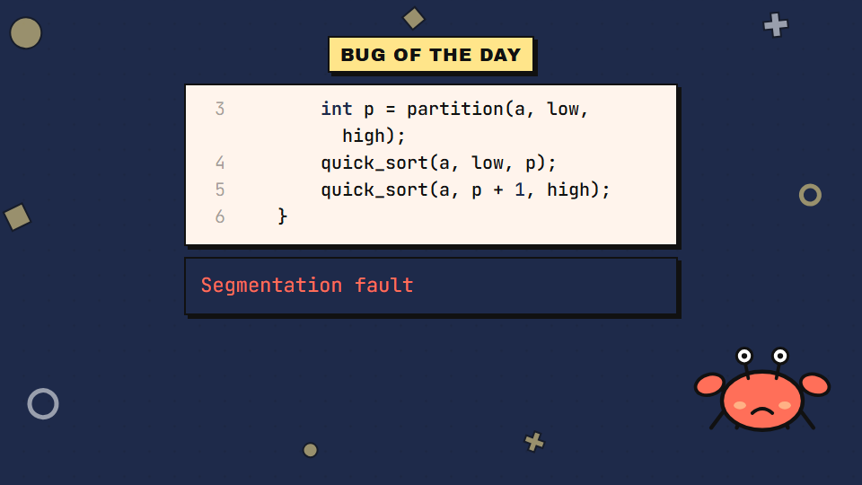 |

Two things seen in the stills: in EP2 the quoted myth appeared twice, so the rule now drops the claim when the code card already shows it (still re-rendered above),
and the EP73 caption was first drawn in ink on the dark-blue background and was unreadable; it now uses the readable colour for the scene background.

## 13. Bug of the Day code window: does it show the culprit? (report only, nothing changed)

**How the window is chosen.** `BugOfTheDay` draws the wrong code in `CodeBlock` with `maxHeight 410`, font 40, width 1100, and passes no `highlightLine` and no `visibleChars`.
The panel is capped to `floor((410 − chrome) / row height)` rows, which is 5 rows (a wrapped line takes 2 rows, so sometimes only 3–4 lines). With nothing to follow, the panel
scrolls to the end, so the window is always **the last rows of the file**, snapped to whole lines. The fixed code gets the same window. The window never looks at where the bug is.

`node scripts/bug_windows.mts` (pure Node, reads `episodes/*.json` and `src/lib/codeLayout.ts`) mirrors that rule for all 86 episodes and checks the window against the bug's line.
The line is the compiler's own line when the error text has `file:LINE:col: error|warning` and the echoed source matches the code, otherwise the line(s) that differ from the fix
(for a pure insertion, the lines around the gap; for a short fragment fix, the wrong line sharing the most identifiers with the fragment). It is a heuristic; the cases below were spot-checked.

- **Wrong-code window does not contain the culprit: 35 episodes** — EP20, 22, 23, 24, 27, 30, 33, 34, 35, 37, 39, 42, 43, 44, 45, 46, 47, 49, 50, 57, 62, 63, 67, 69, 70, 71, 73, 74, 76, 77, 78, 79, 82, 84, 85.
  Checked by hand: EP67 (culprit line 10, the `realloc` line; window 13–17), EP69 (the `fopen` result is used at lines 4–6; window 7–11), EP43 (the unsorted array is line 4; window 19–22).
- **Culprit not decidable by the script: 3** (no compiler line, no matching line) — EP5, EP25, EP83.
- **Wrong slot is prose, so there is no window: 2** — EP2, EP3.
- **Fixed-code window does not contain a changed line: 18** — EP10, 20, 24, 30, 34, 35, 36, 37, 39, 40, 49, 69, 71, 75, 76, 78, 84, 85.
- The other 45 episodes show the culprit.

Of the 35, 19 are in EP20–50 (EP20, 22, 23, 24, 27, 30, 33, 34, 35, 37, 39, 42–47, 49, 50), and 8 of those (EP42–47, 49, 50) are in the EP41–50 4K masters already rendered.
**EP1–19: no wrong-code window misses its culprit.** EP5 is undecidable by the script, EP2 and EP3 have no code window, and EP10's fixed-code window (4–8) does not show the changed line 6.
The window logic is unchanged. A fix would be to centre the window on the culprit (pass it as `highlightLine`) or show more rows.
